# AGENTS.md

```mermaid
flowchart LR
    Code["<span style='position:relative;display:inline-block'><svg class='label-icon' viewBox='0 0 24 24' width='15' height='15' style='position:absolute;left:-32px;top:-15px' fill='none' stroke='currentColor' stroke-width='1.9' stroke-linecap='round' stroke-linejoin='round'><path d='M8.5 7 4 12l4.5 5'/><path d='M15.5 7 20 12l-4.5 5'/></svg>Edit source</span>"] --> Doc["<span style='position:relative;display:inline-block'><svg class='label-icon' viewBox='0 0 24 24' width='15' height='15' style='position:absolute;left:-32px;top:-15px' fill='none' stroke='currentColor' stroke-width='1.9' stroke-linecap='round' stroke-linejoin='round'><path d='M4.5 5h15v14h-15z'/><path d='M8 14.5v-4l2.2 2.8 2.2-2.8v4'/></svg>Update sibling .md<br/>in the same change</span>"]
    Doc --> Regen["<span style='position:relative;display:inline-block'><svg class='label-icon' viewBox='0 0 24 24' width='15' height='15' style='position:absolute;left:-32px;top:-15px' fill='none' stroke='currentColor' stroke-width='1.9' stroke-linecap='round' stroke-linejoin='round'><path d='M5 8l4.5 4L5 16'/><path d='M12 16.5h7'/></svg>scripts/docs.sh</span>"]
    Regen --> Site["<span style='position:relative;display:inline-block'><svg class='label-icon' viewBox='0 0 24 24' width='15' height='15' style='position:absolute;left:-32px;top:-15px' fill='none' stroke='currentColor' stroke-width='1.9' stroke-linecap='round' stroke-linejoin='round'><path d='M3.5 5.7A2.2 2.2 0 0 1 5.7 3.5h4L12 6h5.3a2.2 2.2 0 0 1 2.2 2.2v8.6a2.2 2.2 0 0 1-2.2 2.2H5.7a2.2 2.2 0 0 1-2.2-2.2z'/></svg>./site — git-ignored</span>"]
    Site --> Review["<span style='position:relative;display:inline-block'><svg class='label-icon' viewBox='0 0 24 24' width='15' height='15' style='position:absolute;left:-32px;top:-15px' fill='none' stroke='currentColor' stroke-width='1.9' stroke-linecap='round' stroke-linejoin='round'><path d='M5 12.8 9.7 17.5 19 8'/></svg>Self-review<br/>the changed pages</span>"]
    Review --> Commit["<span style='position:relative;display:inline-block'><svg class='label-icon' viewBox='0 0 24 24' width='15' height='15' style='position:absolute;left:-32px;top:-15px' fill='none' stroke='currentColor' stroke-width='1.9' stroke-linecap='round' stroke-linejoin='round'><path d='M4.5 4.5h6.4a2 2 0 0 1 1.4.6l7.3 7.3a2 2 0 0 1 0 2.9l-4.3 4.3a2 2 0 0 1-2.9 0l-7.3-7.3a2 2 0 0 1-.6-1.4V4.5z'/><circle cx='8.7' cy='8.7' r='0.9' fill='currentColor' stroke='none'/></svg>Commit source<br/>+ doc together</span>"]
    class Code goFile
    class Doc mdFile
    class Regen shFile
    class Site folder
    class Review checkNode
    class Commit tagNode
    classDef goFile fill:#8fd8ef,stroke:#0277a8,color:#08303d
    classDef mdFile fill:#dcd6ce,stroke:#6b6255,color:#292524
    classDef shFile fill:#abe07a,stroke:#3f6212,color:#16280a
    classDef folder fill:#f0c558,stroke:#8a6d1c,color:#332a05
    classDef checkNode fill:#9fe8c9,stroke:#0f766e,color:#052e22
    classDef tagNode fill:#f6b8d4,stroke:#be185d,color:#500724
```



## Project Overview

barnacle is a documentation-site generator written in Go. It turns Markdown (`.md`) and Mermaid (`.mmd`) files scattered through a repository into a static, navigable HTML website — documentation lives next to the code it describes.

It ships as a single dependency-light binary: the only direct dependency is `github.com/yuin/goldmark` (GFM Markdown). Mermaid diagrams are rendered in the browser from a bundled `mermaid.min.js`.

## Core Principles

- **Documentation lives with the code.** Sibling `.md`/`.mmd` files are the contract; the tool reads them in place, never a separate docs tree.
- **Mermaid-forward.** Every page opens with a Mermaid diagram right under its `#` heading — the reader gets the map before the territory. This is guidance, never a hard rule: barnacle only prints a non-fatal note listing pages without a diagram (`.barnacle.json` key `warnMissingMermaid`, default `true`). When you add or rewrite a page, open it with a diagram — a flowchart, class diagram, sequence diagram, state diagram, dependency graph — whatever best communicates the thing you are documenting to someone who has never seen it.
- **Static, portable output.** No server, no database; the generated site works from any base URL (`file://`, GitHub Pages, any static host).
- **Fail loudly.** A missing documented file is an error; a `.md`/`.mmd` stem collision fails the whole build; an explicitly requested config that is missing or invalid is an error.
- **No magic.** The HTML shell and stylesheet are embedded with `go:embed`; the scan excludes `.git`, `node_modules`, `vendor`, `dist`, and the output directory — nothing else is hidden.
- **Dogfood the toolchain.** The repository formats itself with formattington via `uv`, releases with versioner, logs with logamuffin, and renders its own documentation with a barnacle built from this tree (`scripts/build.sh` builds `dist/<platform>/barnacle[.exe]`; `scripts/docs.sh` runs it — pass `BARNACLE_BIN=` to override). Nothing is pinned, so the site always reflects the current source; on stderr barnacle notes any pages still missing a diagram.

## Build and Test

Requires the Go toolchain from `go.mod` (Go 1.27) and, for formatting, `uv`.

```bash
go build ./cmd/barnacle   # build the binary
go test ./...             # run the test suite (includes end-to-end browser tests)
go vet ./...              # static analysis
./scripts/format.sh             # format in place (prettier, black, shfmt -i 2, taplo)
./ci/format_check.sh    # check formatting without modifying files (CI)
scripts/build.sh          # cross-compile into dist/<platform>/barnacle{,.exe}
scripts/docs.sh           # regenerate the documentation site into ./site/
```

The end-to-end tests generate a fixture site and verify it in two layers: statically (every relative link target must exist, no unrewritten `.md`/`.mmd` targets remain) and in a headless browser (every generated page and every unique anchor target must load, and every Mermaid diagram must render). The browser layer needs Chrome or Chromium on the machine and is skipped otherwise; set `BARNACLE_CHROME` to the executable to force it. CI runs on macOS and Windows self-hosted runners, where the browser layer runs if Chrome/Edge is installed.

CI (`.github/workflows/ci.yml`) runs on self-hosted macOS and Windows runners: `./ci/format_check.sh`, `go vet`, `gofmt -l .`, `go test ./...`, and `go build ./...`. The runners are managed with [runner-spawner](https://github.com/fordaj/runner-spawner) (see `.runner-spawner.json` and `tools/runner-spawner/`).

Releases go through `scripts/release.sh` (`--build-only` and `--dry-run` are the safe entry points); it computes the version with versioner, verifies `barnacle --version` agrees, and publishes per-platform archives. Do not tag or release without an explicit request.

## Repository Layout

```text
cmd/barnacle/     the process boundary (main.go — flag parsing, exit codes)
internal/barnacle/ the whole implementation (config, scan, render, nav, site, template)
scripts/          build/release/docs tooling (+ hidden .common.env / .<platform>.env cascade)
tools/            pinned helper binaries, each with an update.sh (not Go deps)
ci/               format check for CI
scripts/format.sh  formatter (formattington via uv)
site/             generated documentation (git-ignored)
```

Important files include `cmd/barnacle/main.go`, `internal/barnacle/{config,scan,render,nav,site,template}.go`, `internal/barnacle/assets/{barnacle.css,mermaid.min.js}` (embedded), and the scripts under `scripts/`.

## Documentation files (barnacle)

The repository's documentation is a set of Markdown (`.md`) and Mermaid (`.mmd`) source files rendered into a static site by a barnacle built from this tree — `scripts/build.sh` produces `dist/<platform>/barnacle[.exe]` (wired into the environment cascade as `BARNACLE_BIN`) and `scripts/docs.sh` runs it. Generate the site with `scripts/docs.sh` (nothing is pinned, so the site always reflects the current tree); the output (`./site/`) is git-ignored and never committed.

Layout — documentation lives next to the code it describes:

- One sibling `.md` per Go file in `cmd/barnacle/` and `internal/barnacle/` (for example `scan.go` → `scan.go.md`), plus `internal/barnacle/README.md` as the package hub.
- One sibling `.md` per bash script (`scripts/entry.sh` → `entry.sh.md`, `scripts/env.sh` → `env.sh.md`, `scripts/version.sh` → `version.sh.md`, `scripts/docs.sh` → `docs.sh.md`, `scripts/build.sh` → `build.sh.md`, `scripts/release.sh` → `release.sh.md`, `scripts/format.sh` → `scripts/format.sh.md`), plus `scripts/README.md` as the hub.
- One sibling `.md` per bundle in `tools/` (`tools/<name>/update.sh.md`), plus `tools/README.md` as the hub. `tools/` is excluded from the generated site via `.barnacle.json` (the pinned binaries carry their own upstream docs), so these pages exist for the repository, not the site.

Naming rules:

- **Retain the documented file's suffix.** A documentation file for `main.py` is `main.py.md`; for `main.cpp` it is `main.cpp.md`; for `parser.cpp` it is `parser.cpp.md` (or `parser.cpp.mmd`). This is the convention for everything in this repository, and it exists so files that share a base name can be documented individually.
- Free-standing diagrams that do not document one specific file (for example `architecture.mmd`) may use a plain name.
- Hub pages (`README.md` in each documented directory) keep their plain names.

Rules for keeping these files current:

- When you add, rename, remove, or repurpose a documented file — a Go file, a script, or a bundle — update its sibling `.md` **in the same change**. A new file without its page is incomplete work; a stale page is worse than none.
- **Every page opens with a Mermaid diagram** under its `#` heading (guidance, not a hard rule): what the thing is and how it fits, in the diagram type that fits best. If a page you touch has no diagram at the top, add one. Follow the README's "Diagram conventions" (colored classes for file kinds, hexagon decisions, corner glyphs — file-kind upper-left, chain link upper-right when the node is clickable — colors that read on light and dark) — it is the house style, not something barnacle enforces.
- Source every fact: the `.go`/`.sh`/`.env` file itself, this file (AGENTS.md), and README.md are the accepted sources. Never invent flags, exit codes, extensions, or bundle-platform matrices.
- Use plain relative links (`scan.go.md`, `../../README.md`) with the linking file's `.md` path — barnacle rewrites them to `.html`. Do not link to files barnacle does not render (binaries, `.sh`, `LICENSE`); link the related `.md` page (for external references, a full `https://` URL is fine). Pages that are not rendered (`tools/`) may still be linked from other unrendered pages; rendered pages must not hyperlink into `tools/` — refer to those pages as code (for example `tools/versioner/update.sh.md`), because `.barnacle.json` excludes them from the site.
- Mermaid `click` directives are rewritten too (`click Scan href "scan.go.md"`), so diagram nodes may link between pages — prefer this in the top-of-page diagram; it makes the site explorable by diagram alone. Transitions work the same way with an inline anchor in the label (`Idle --> Waiting : <a href="scan.go.md">send(cmd)</a>`, see the README's "Clickable edges") — no JS, no directives.
- A `foo.md` and a `foo.mmd` may not coexist for the same stem — barnacle fails the whole site rather than overwriting. The same applies with retained suffixes: `main.py.md` and `main.py.mmd` both generate `main.py.html`.
- Hub pages (`README.md` in each documented directory) list their siblings; adding a page means linking it from the hub too, in the same order as the rest of the directory's list.
- Barnacle skips hidden files by default, so the `.common.env` and `.<platform>.env` cascade is documented inside `scripts/env.sh.md` — keep it accurate there instead of adding hidden doc files.
- Regenerate and self-review the site before publishing: `scripts/docs.sh`, then click through the changed pages. The generator output must remain free of broken local links.

Definition of Done addition: a change that touches any documented file updates (or creates) its sibling page in the same commit — including the diagram at the top.

## Definition of Done

A change is complete when it:

- Implements the requested behavior.
- Preserves the CLI contract (`--config`, `--site`, `--version`, exit codes `0`/`1`/`2`) unless intentionally changed.
- Handles missing files, invalid configuration, and IO errors explicitly, without panics.
- Remains cross-platform (path handling via `path/filepath`, no shelling out unless explicitly required).
- Includes or updates tests where appropriate (`go test ./...` passes).
- Leaves the formatting clean (`./ci/format_check.sh`).
- Updates relevant documentation — including the sibling `.md` pages above for every Go, bash, or bundle file touched, and `scripts/docs.sh` re-run with no broken local links.
