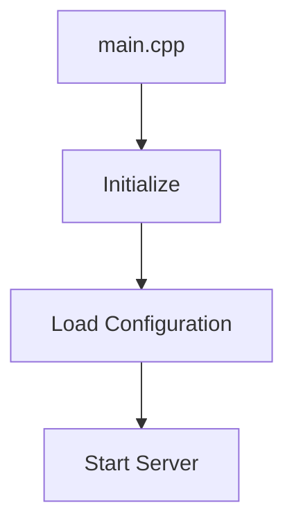
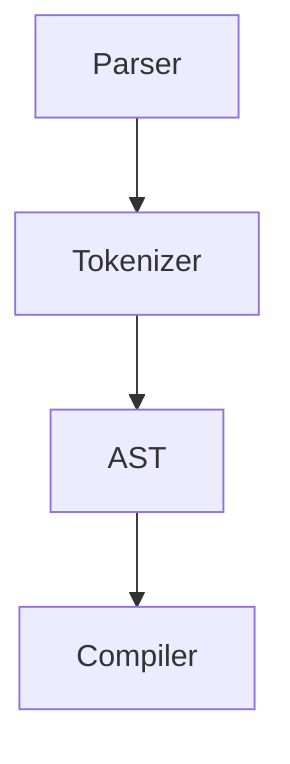

# barnacle

**Navigate your codebase through diagrams.**

Barnacle generates a static, navigable HTML site from Mermaid diagrams and Markdown documentation distributed throughout a codebase.

Instead of maintaining a separate documentation directory, keep diagrams alongside the code they describe. Barnacle discovers these files, renders Mermaid diagrams to SVG, resolves relative links, and brings everything together into a browsable website.

## Why Barnacle?

Codebases are easier to understand when you can visualize how their pieces fit together.

Mermaid makes diagrams easy to write, review, and maintain as plain text. But diagrams become much more useful when they can link to one another and to the actual source files they describe.

Barnacle makes that possible without introducing a separate documentation system.

For example:

```text
my-project/
├── src/
│   ├── main.cpp
│   ├── main.md
│   ├── parser.cpp
│   ├── parser.mmd
│   └── network/
│       ├── client.py
│       └── client.md
└── .barnacle.json
```

Each documentation file lives alongside its corresponding source file.

- `main.md` documents `main.cpp`.
- `parser.mmd` visualizes `parser.cpp`.
- `client.md` documents `client.py`.

These files can link to one another using ordinary relative paths.

Barnacle transforms this distributed documentation into a single navigable site.

## Features

- **Parallel documentation** — Keep `.md` and `.mmd` files next to the source files they describe.
- **Mermaid rendering** — Render Mermaid diagrams to SVG during the build.
- **Navigable diagrams** — Follow links between diagrams and documentation.
- **Source code links** — Link directly to the corresponding source files.
- **Relative links** — Maintain relationships between files without hardcoding repository URLs.
- **Static output** — Generate plain HTML, CSS, and SVG files. No server required.
- **Cross-platform** — Distribute platform-specific executables through npm.
- **Configurable** — Customize discovery and output through `.barnacle.json` or a command-line config path.

## Installation

Install Barnacle as a development dependency:

```bash
npm install --save-dev barnacle
```

Or run it without adding it to your project:

```bash
npx barnacle
```

## Usage

Run Barnacle from the root of your repository:

```bash
npx barnacle
```

By default, Barnacle:

1. Discovers Markdown and Mermaid documentation files.
2. Resolves their relationships using relative paths.
3. Renders Mermaid diagrams to SVG.
4. Generates a navigable HTML site.
5. Writes the generated site to `./site`.

### Command-line options

| Option            | Description                        |
| ----------------- | ---------------------------------- |
| `--config <path>` | Use a specific configuration file. |
| `--site <path>`   | Override the output directory.     |
| `--help`          | Display usage information.         |
| `--version`       | Display the installed version.     |

Examples:

```bash
# Use default configuration
npx barnacle

# Specify a configuration file
npx barnacle --config ./docs/barnacle.json

# Change the output directory
npx barnacle --site ./build/docs

# Use both options
npx barnacle --config ./barnacle.json --site ./public
```

## Documentation files

Barnacle recognizes two documentation formats.

### Markdown (`.md`)

Markdown files support prose, links, and Mermaid code blocks.

````markdown
# Application Entry Point

The application starts here.



See the [parser documentation](../parser.mmd).
````

### Mermaid (`.mmd`)

Mermaid files contain standalone diagrams.



They can also contain links to other documentation and source files.

## Linking files

Links are resolved relative to the documentation file containing them.

For example, given:

```text
src/
├── main.cpp
├── main.md
├── parser/
│   ├── parser.cpp
│   └── parser.md
└── network/
    ├── client.py
    └── client.md
```

`main.md` could contain:

```markdown
- [Parser](parser/parser.md)
- [Network Client](network/client.md)
- [Source Code](main.cpp)
```

Barnacle resolves these relationships when generating the site, allowing readers to navigate between documentation and source files.

Links inside Mermaid diagrams should follow the same relative-path conventions.

## Configuration

Barnacle looks for `.barnacle.json` in the repository root by default.

An alternative configuration can be specified with `--config`.

Example:

```json
{
  "include": ["**/*.md", "**/*.mmd"],
  "exclude": ["site/**", "node_modules/**", ".git/**"]
}
```

Command-line options take precedence over configuration values.

## Output

Barnacle generates a self-contained static website.

```text
site/
├── index.html
├── assets/
│   ├── styles.css
│   └── ...
└── src/
    ├── main.html
    ├── main.svg
    ├── parser/
    │   ├── parser.html
    │   └── parser.svg
    └── network/
        └── client.html
```

The generated site preserves the source documentation's directory structure, making relative relationships predictable.

The site can be:

- Opened locally in a browser.
- Hosted using GitHub Pages.
- Published using any static hosting provider.
- Attached to CI artifacts.
- Shared with other developers without requiring Barnacle to be installed.

## Development

Barnacle is written in TypeScript and built using [Bun](https://bun.sh).

Bun is used to produce platform-specific standalone executables for distribution through npm.

### Requirements

- [Bun](https://bun.sh)

### Build

```bash
bun install
bun run build
```

### Test

```bash
bun test
```

## Design philosophy

Barnacle aims to make codebase documentation:

- **Close to the code** — Documentation belongs beside the implementation it describes.
- **Easy to maintain** — Markdown and Mermaid are readable, version-controllable text files.
- **Easy to navigate** — Diagrams should connect to other diagrams and actual source files.
- **Portable** — Generated documentation should work without a running application or backend.
- **Low maintenance** — Developers and coding agents should be able to update documentation without learning a complicated documentation framework.

Barnacle doesn't try to replace your source code, IDE, or existing documentation tools. It gives your codebase a visual map.

---

**Barnacle — Make your codebase navigable.**
