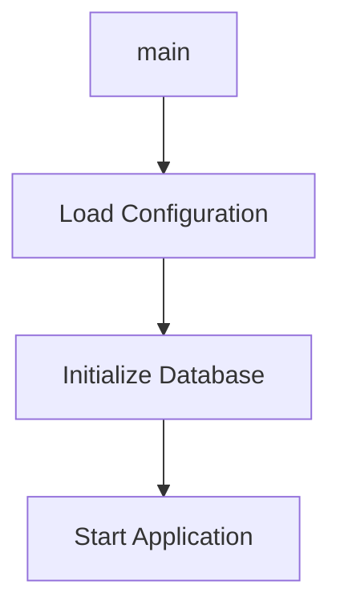
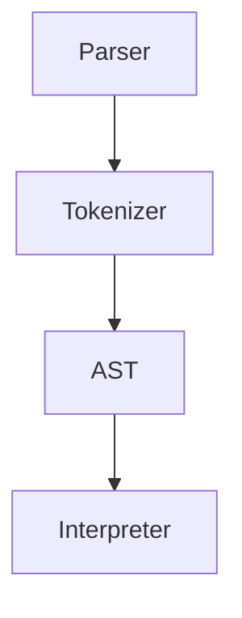

# barnacle

**A navigable, diagram-centric documentation site for your codebase.**

Barnacle turns Markdown and Mermaid documentation files scattered throughout a repository into a static, interconnected HTML website.

Document your code where it lives. Visualize how it fits together. Navigate your codebase through diagrams and links.

## Why barnacle?

Understanding an unfamiliar codebase often means jumping between source files, documentation, diagrams, and references scattered throughout a repository.

Barnacle takes a different approach: keep documentation alongside the code it describes.

For example:

```text
my-project/
├── main.cpp
├── main.md
├── parser/
│   ├── parser.cpp
│   └── parser.mmd
├── networking/
│   ├── client.py
│   └── client.md
└── .barnacle.json
```

A documentation file can live directly beside its corresponding source file:

- `main.cpp` → `main.md`
- `parser.cpp` → `parser.mmd`
- `client.py` → `client.md`

Run Barnacle against your repository to generate a static website containing rendered diagrams and navigable documentation pages.

The result is a visual map of your codebase that developers and coding agents can maintain as the code evolves.

## Features

- **Documentation alongside code** — Keep `.md` and `.mmd` files parallel to the source files they describe.
- **Mermaid-first** — Use Mermaid diagrams to illustrate architecture, control flow, dependencies, and relationships.
- **Navigable documentation** — Generated pages link to one another using relative paths.
- **Static HTML output** — No application server or backend required to serve the generated site.
- **Browser-rendered diagrams** — Mermaid diagrams are rendered by the browser.
- **Portable** — Generated sites can be hosted anywhere static files can be served.
- **Cross-platform binaries** — Written in Go and distributed as precompiled binaries for major operating systems and architectures.

## Getting started

Place documentation files alongside the source files they describe:

```text
project/
├── main.py
├── main.md
├── database.py
├── database.mmd
└── .barnacle.json
```

Generate the site:

```bash
barnacle
```

By default, Barnacle reads configuration from `.barnacle.json` in the repository root and writes generated HTML files to `./site`.

Open the generated site in a browser to explore your documentation.

## Usage

```bash
barnacle [options]
```

| Option            | Description                                                       |
| ----------------- | ----------------------------------------------------------------- |
| `--config <path>` | Path to a Barnacle configuration file.                            |
| `--site <path>`   | Output directory for the generated website. Defaults to `./site`. |

Examples:

```bash
# Use repository configuration and default output directory
barnacle

# Specify a configuration file
barnacle --config ./docs/barnacle.json

# Specify an output directory
barnacle --site ./public

# Specify both
barnacle --config ./config/barnacle.json --site ./build/site
```

## Documentation files

Barnacle uses documentation files that live alongside your source code.

Both Markdown (`.md`) and Mermaid (`.mmd`) files can be used.

### Markdown

Markdown files can contain explanatory text, links, and Mermaid diagrams.

````markdown
# Application Entry Point

The application starts here and initializes the major subsystems.



See [Database](database.md) for more information.
````

### Mermaid

Mermaid files provide a dedicated place for diagrams without requiring surrounding Markdown.



### Linking documentation

Documentation files can reference other documentation files using relative Markdown links.

For example:

```markdown
See [the parser](../parser/parser.md) for implementation details.
```

Links remain relative in the generated site, allowing documentation to remain portable across directories and hosting environments.

## Output

Barnacle generates a static HTML website in `./site` by default.

The generated site mirrors the documentation structure, providing HTML pages that can link to one another.

```text
site/
├── index.html
├── main.html
├── parser/
│   └── parser.html
└── networking/
    └── client.html
```

Mermaid diagrams are rendered in the browser. The generated website requires no backend service or application runtime.

The output can be:

- Opened locally in a browser.
- Published using GitHub Pages.
- Hosted on any static web server.
- Distributed as part of a repository or project artifact.

## Configuration

Barnacle supports repository-level configuration through `.barnacle.json`.

Alternatively, specify a configuration file using `--config`.

```text
my-project/
├── .barnacle.json
├── main.cpp
├── main.md
└── ...
```

Configuration allows repository-specific behavior without requiring developers to repeatedly supply command-line arguments.

## Built with Go

Barnacle is written in Go and designed to be distributed as standalone, cross-compiled binaries.

Release builds target major operating systems and processor architectures, allowing developers to use Barnacle without installing Go, Python, Node.js, or other runtimes.

## Philosophy

Documentation should be:

- **Close to the code** — Developers should be able to find and update documentation without hunting through a separate documentation repository.
- **Easy to maintain** — Plain-text files work naturally with Git, code review, and automated coding agents.
- **Visual** — Diagrams communicate architecture and relationships more effectively than walls of prose.
- **Connected** — A codebase is a network of relationships. Its documentation should be navigable in the same way.
- **Portable** — Documentation should be usable without a running application, database, or specialized infrastructure.

**Barnacle makes your codebase explorable.**
