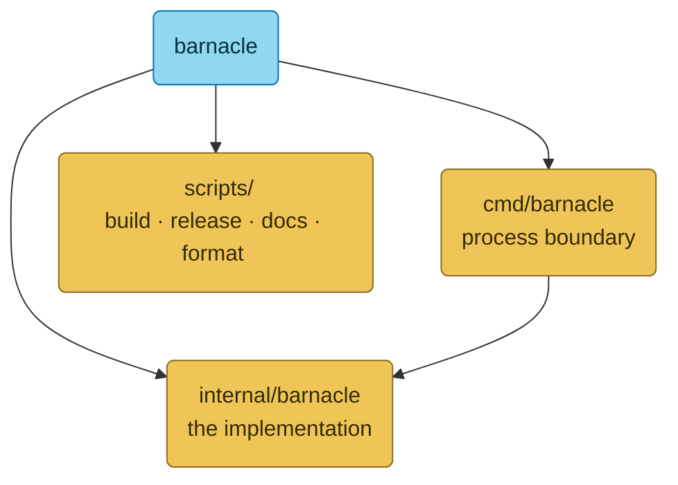
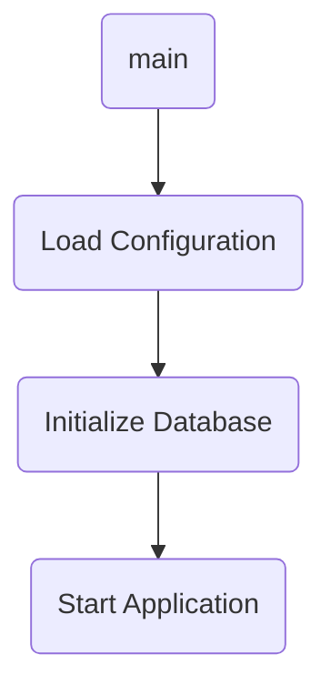
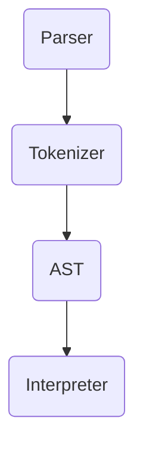
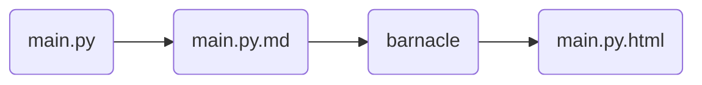
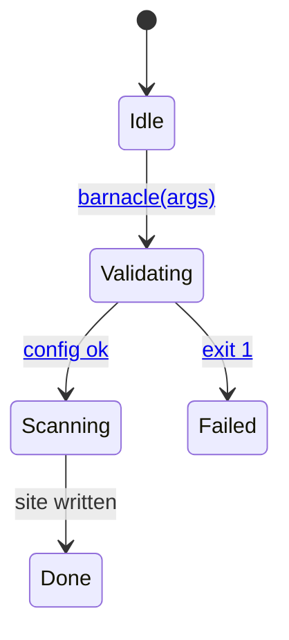
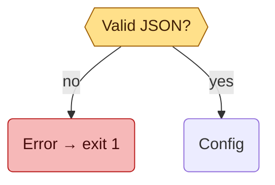

# barnacle



**A navigable, diagram-centric documentation site for your codebase.**

Barnacle turns Markdown and Mermaid documentation files scattered throughout a repository into a static, interconnected HTML website.

Document your code where it lives. Visualize how it fits together. Navigate your codebase through diagrams and links.

## Why barnacle?

Understanding an unfamiliar codebase often means jumping between source files, documentation, diagrams, and references scattered throughout a repository.

Barnacle takes a different approach: keep documentation alongside the code it describes.

For example:

```text
my-project/
├── main.cpp
├── main.cpp.md
├── parser/
│   ├── parser.cpp
│   └── parser.cpp.mmd
├── networking/
│   ├── client.py
│   └── client.py.md
└── .barnacle.json
```

A documentation file can live directly beside its corresponding source file:

- `main.cpp` → `main.cpp.md`
- `parser.cpp` → `parser.cpp.mmd`
- `client.py` → `client.py.md`

Run Barnacle against your repository to generate a static website containing rendered diagrams and navigable documentation pages.

The result is a visual map of your codebase that developers and coding agents can maintain as the code evolves.

## Features

- **Documentation alongside code** — Keep `.md` and `.mmd` files parallel to the source files they describe.
- **Mermaid-forward** — Every page should open with a Mermaid diagram at the top, so a brand-new reader gets a visual map before a wall of prose. Barnacle guides you (and your agents) toward that; it never forces it.
- **Diagram conventions** — Per-file-kind node colors, hexagon decisions, and inline Lucide glyphs (file kind first, chain link last when clickable): conventions this repository follows and this README documents; nothing Barnacle enforces. See [Diagram conventions](#diagram-conventions).
- **Clickable diagrams** — `click` directives make diagram nodes and edges navigable; Barnacle rewrites documentation targets (`.md`/`.mmd`) inside them to the generated pages. See [Clickable diagrams](#clickable-diagrams).
- **Navigable documentation** — Generated pages link to one another using relative paths.
- **Retained suffixes** — `main.py.md`, `main.cpp.md`, `main.rs.md` — documentation files keep the source file's suffix, so different files that share a base name stay individually documentable.
- **Static HTML output** — No application server or backend required to serve the generated site.
- **Browser-rendered diagrams** — Mermaid diagrams are rendered by the browser.
- **Portable** — Generated sites can be hosted anywhere static files can be served.
- **Cross-platform binaries** — Written in Go and distributed as precompiled binaries for major operating systems and architectures.

## Getting started

Place documentation files alongside the source files they describe:

```text
project/
├── main.py
├── main.py.md
├── database.py
├── database.py.mmd
└── .barnacle.json
```

Generate the site:

```bash
barnacle
```

By default, Barnacle reads configuration from `.barnacle.json` in the repository root and writes generated HTML files to `./site`.

Open the generated site in a browser to explore your documentation.

## Usage

```bash
barnacle [options]
```

| Option            | Description                                                       |
| ----------------- | ----------------------------------------------------------------- |
| `--config <path>` | Path to a Barnacle configuration file.                            |
| `--site <path>`   | Output directory for the generated website. Defaults to `./site`. |

Examples:

```bash
# Use repository configuration and default output directory
barnacle

# Specify a configuration file
barnacle --config ./docs/barnacle.json

# Specify an output directory
barnacle --site ./public

# Specify both
barnacle --config ./config/barnacle.json --site ./build/site
```

## Documentation files

Barnacle uses documentation files that live alongside your source code.

Both Markdown (`.md`) and Mermaid (`.mmd`) files can be used.

### Naming a page after a source file

When a documentation file documents a source file, **keep the source file's suffix in the documentation file name**: `main.py` is documented by `main.py.md`, `main.cpp` by `main.cpp.md`, `main.rs` by `main.rs.md`, `parser.cpp` by `parser.cpp.mmd`.

This is guidance, not a rule — Barnacle renders plain names too — but it is the naming convention this project recommends, and the one its own documentation uses. Retaining the suffix:

- keeps different files that share a base name individually documentable (`main.py.md`, `main.cpp.md`, `main.rs.md`),
- keeps the pairing visible to Git, to editors, and to coding agents scanning the tree,
- makes the generated page name unambiguous (`main.py.html`, `main.cpp.html`, `main.rs.html`).

Collisions work exactly as before: a `foo.md` and a `foo.mmd` with the same stem both produce `foo.html`, so Barnacle fails with a clear error instead of silently overwriting one — for example `main.py.md` and `main.py.mmd` both describe `main.py` and both generate `main.py.html`.

Free-standing diagrams that do not document one particular file (for example `architecture.mmd`) may keep plain names.

### Markdown

Markdown files can contain explanatory text, links, and Mermaid diagrams. Best practice is a diagram at the very top of the page, right under the `#` heading:

````markdown
# Application Entry Point



The application starts here and initializes the major subsystems. See [Database](database.py.md) for more information.
````

### Mermaid

Mermaid files provide a dedicated place for diagrams without requiring surrounding Markdown — useful for larger diagrams or sources that generate them. A `.mmd` file documenting a source file keeps the source suffix (`parser.cpp.mmd`); a free-standing diagram may use a plain name:



### A diagram at the top of every page

The recommended shape of every page — this is the convention this repository follows and the one coding agents are instructed to follow — is:

1. `# Title` — matches what the page is about,
2. a Mermaid diagram giving a brand-new reader the map of the territory the page covers,
3. prose, links, and details.

Think from the perspective of a newcomer clicking their way around the generated site: the diagram answers "what am I looking at, and where does it fit?" before any prose does. It does not have to be a flowchart — a class diagram, a sequence diagram, a state diagram, or a dependency graph all work; whatever communicates the shape of the thing best. Two or three nodes of substance beat a diagram that merely repeats the heading.

Barnacle guides this, it does not force it: pages that contain no Mermaid diagram are reported once per generation as a non-fatal note listing the pages (`barnacle: note: N page(s) have no Mermaid diagram: …`), alongside the best-practice reminder. Nothing fails, nothing is blocked. Set `"warnMissingMermaid": false` in `.barnacle.json` to silence the note.

### Linking documentation

Documentation files can reference other documentation files using relative Markdown links.

For example:

```markdown
See [the parser](../parser/parser.cpp.md) for implementation details.
```

Links remain relative in the generated site, allowing documentation to remain portable across directories and hosting environments.

### Clickable diagrams

Mermaid flowcharts natively support `click` directives, which make individual nodes navigable. Barnacle goes one step further: **documentation targets (`.md`, `.markdown`, `.mmd`) inside `click` directives are rewritten to their generated `.html` pages**, exactly like Markdown links — so clicking a diagram node opens the documentation page it points at. Relative targets are resolved against the page URL; because the generated site mirrors the source tree, swapping the extension is all that is needed.



(Above: a real diagram from this repository — nodes link to the pages you are looking at.)

Notes:

- Syntax forms: `click A href "target.md"`, optionally with a tooltip (`"tooltip"`) and `_blank`/`_self` target; the shorthand `click A "target.md"` also works. Multi-node lists (`click A,B href "target.md"`) work.
- Targets that are not documentation files (absolute URLs, `mailto:`, fragments) are left untouched. Targets are matched case-insensitively by extension; `.md`, `.markdown` and `.mmd` all rewrite to `.html`.
- Clicking works with Barnacle's default `securityLevel: 'strict'`: relative URLs pass Mermaid's sanitizer, which blocks `javascript:`-style URLs. JavaScript callbacks (`click A callback` / `click A call fn()`) are a Mermaid feature that requires `securityLevel: 'loose'` and remain unavailable — Barnacle deliberately ships strict.
- Standalone `.mmd` files get the same rewriting.
- Clicks are relative to the current page, so write targets the same way you would write a Markdown link from that page (`../parser/parser.cpp.md`).

### Clickable edges

Mermaid has no edge-`click` grammar, but its edge labels render as HTML inside the SVG — so **an inline anchor in the label just works**, and barnacle rewrites its `href` like any other doc link:



Try it: `barnacle(args)` and `config ok` jump to the Configuration and Features sections **on this page**; `exit 1` takes you to **another page**.

Syntax notes (mermaid's own quirks, not barnacle's):

| Construct                                                | Rule                                                                                                |
| -------------------------------------------------------- | --------------------------------------------------------------------------------------------------- |
| `Idle --> Waiting : <a href="dispatch.md">send(cmd)</a>` | State diagrams — the label is free-form, but may **not contain `:`** at all, or the parser gives up |
| `A -->\|<a href="dispatch.md">sendcmd</a>\| B`           | Flowchart labels without parens are fine as-is                                                      |
| `A -->\|"<a href='dispatch.md'>send(cmd)</a>"\| B`       | Flowchart labels **with parens** must be quoted; use single quotes inside the double-quoted label   |
| `<a href="x.md" title="Send the command">…</a>`          | Standard attributes (`href`, `title`, `target="_blank"`, fragments) pass through under `strict`     |
| `<a href="#local">…</a>`                                 | Fragment-only targets are untouched                                                                 |
| Markdown                                                 | Not interpreted in plain labels — `**bold**` prints literally; use HTML (`<br/>`, `<strong>`)       |
| `click A callback`                                       | Still requires `securityLevel: 'loose'`, which barnacle does not enable                             |

Rules for links inside labels (identical to node clicks and everything else):

- `.md` / `.markdown` / `.mmd` targets rewrite to `.html` — fragments and queries preserved; relative paths resolve from the page URL.
- Absolute URLs, fragments and `mailto:` pass through untouched.
- External and non-doc-fragment targets are never touched.
- Standalone `.mmd` files are treated the same way.

Node clicks (`click A href "target.md"`) remain the blessed way to make **nodes** navigable; inline anchors are the way to make **transitions** navigable. Both rely on the same label/SVG rendering under `securityLevel: 'strict'`: labels go through DOMPurify, which keeps relative URLs (and strips `javascript:`).

### Diagram conventions

Mermaid's own features get you a lot of polish for free — colored classes, compact shapes, HTML labels — and this repository uses them throughout its diagrams. Barnacle neither knows about nor enforces any of this; it is simply the house style, shown here so you can copy it. Everything below works under `securityLevel: 'strict'` and reads well on both light and dark pages: the class fills are mid-tone with near-black text, so they stay legible regardless of the page theme behind them.

**Color by file kind.** A handful of `classDef`s, recolored per language, make a diagram scannable at a glance. Keep the fills mid-tone and the text near-black and the same palette survives light and dark mode. This repository's palette (copy the ones you use into each diagram — mermaid scopes classes to a single diagram, and there is no global hook):

```mermaid
flowchart LR
    Go("<img src='tools/lucide/icons/file-code.svg' width='20' alt=''/> scan.go — Go") --> Sh("<img src='tools/lucide/icons/terminal.svg' width='20' alt=''/> build.sh — Bash") --> Json("<img src='tools/lucide/icons/braces.svg' width='20' alt=''/> .barnacle.json — JSON") --> Md("<img src='tools/lucide/icons/file-text.svg' width='20' alt=''/> README.md — Markdown") --> Html("<img src='tools/lucide/icons/app-window.svg' width='20' alt=''/> index.html — generated") --> Js("<img src='tools/lucide/icons/zap.svg' width='20' alt=''/> mermaid.min.js — JavaScript")
    Tag("<img src='tools/lucide/icons/tag.svg' width='20' alt=''/> v0.1.0 — release tag") --> Dl("<img src='tools/lucide/icons/download.svg' width='20' alt=''/> gh release download") --> Check("<img src='tools/lucide/icons/check.svg' width='20' alt=''/> verify checksums") --> Box("<img src='tools/lucide/icons/package.svg' width='20' alt=''/> dist/barnacle.tar.gz")
    class Go goFile
    class Sh shFile
    class Json jsonFile
    class Md mdFile
    class Html htmlFile
    class Js jsFile
    class Tag tagNode
    class Dl dlNode
    class Check checkNode
    class Box boxNode
    classDef goFile fill:#8fd8ef,stroke:#0277a8,color:#08303d
    classDef shFile fill:#abe07a,stroke:#3f6212,color:#16280a
    classDef jsonFile fill:#cdb9f7,stroke:#6d28d9,color:#2e1065
    classDef mdFile fill:#dcd6ce,stroke:#6b6255,color:#292524
    classDef htmlFile fill:#ffc48a,stroke:#c2410c,color:#431407
    classDef jsFile fill:#fbe86f,stroke:#a16207,color:#423806
    classDef tagNode fill:#f6b8d4,stroke:#be185d,color:#500724
    classDef dlNode fill:#93e2e2,stroke:#0f766e,color:#042f2e
    classDef checkNode fill:#9fe8c9,stroke:#0f766e,color:#052e22
    classDef boxNode fill:#e8cf9d,stroke:#a16207,color:#33240a
```



Assign them with `class NodeA,NodeB goFile` — the `:::` shorthand works too, but one form everywhere keeps the source greppable.

```mermaid
flowchart LR
    Scan("<img src='tools/lucide/icons/file-code.svg' width='20' alt=''/> Scan <img src='tools/lucide/icons/link.svg' width='16' alt=''/>")
    Site("<img src='tools/lucide/icons/folder.svg' width='20' alt=''/> site/ <img src='tools/lucide/icons/link.svg' width='16' alt=''/>")
    Scan --> Site
    click Scan href "internal/barnacle/scan.go.md"
    click Site href "internal/barnacle/site.go.md"
    class Scan goFile
    class Site folder
    classDef goFile fill:#8fd8ef,stroke:#0277a8,color:#08303d
    classDef folder fill:#f0c558,stroke:#8a6d1c,color:#332a05
```

**Inline glyphs — file kind first, chain link on clickable nodes.** Icons are the real [Lucide](https://lucide.dev) set, vendored at `tools/lucide/` (ISC-licensed; see `tools/lucide/LICENSE`) and referenced straight from the diagram source as plain Markdown inline images. Labels are HTML, so an inline `` just works under `securityLevel: 'strict'`; barnacle inlines local `.svg` references itself at generation time, so no request ever goes out to disk.



The file-kind glyph is picked to match the class — a folder for `scripts/`, `</>`-style code for Go source, a terminal prompt for shell, braces for JSON, a page for Markdown, a window for HTML, a bolt for JavaScript, a tag for releases, an arrow for downloads, a check for verifications, a box for archives, a hexagon outline for decisions, an exclamation circle for fatal exits. The chain link appears **only** on nodes with a `click` directive; unclickable nodes carry nothing. Everything happens inside the label flow — no absolute positioning, no magic offsets, so it works for any node shape and any wrap; you decide where the line breaks (`<br/>`) and where the `` goes. Notes:

- Mermaid treats the label as HTML and handles `<`, `>`, `&` and quotes for you; escaped-text entities work in labels (`&lt;name&gt;` for a literal `<name>`, `<br/>` for a line break).
- A relative `` is inlined by barnacle as inline `<svg>`; an absolute URL or `data:` URI is left alone; a missing or unreadable file (or a path that escapes the repository root) fails the render with a clear error naming the page.
- Icons stroke in `currentColor`, so they follow the node's **text color** — control it with `classDef … color:#xyz`. The `style id fill:…, stroke:…` directive only restyles the node's outer shape; it does not recolor the icons (they inherit the label's text color). To color icons independently of the text, set `color:` in the classDef.
- Barnacle re-serializes each inlined SVG onto a single line so the newlines in the icon source can't spook mermaid into emitting stray `<br/>`s inside the label. Shapes are also forced to `fill="none"` via inline style so mermaid's theme rules (which paint `.node path { fill: #ECECFF; }` and `.node .label-icon path { fill: currentColor; }`) can't turn stroke-only icons into solid blobs.

**Hexagons for conditions.** Mermaid's diamond shape (`{...}`) balloons with long condition text; the hexagon (`{{...}}`) stays vertically compact and reads just as well as a decision:



**Putting it together** — a small node glossary this repository sticks to: tinted text nodes everywhere (following the `folder`/`goFile`/`shFile`/`jsonFile`/`mdFile`/`htmlFile`/`jsFile` classes for the corresponding file kinds), `hexNode` for decisions, `errNode` for fatal exits, `tagNode` for releases and tags, `dlNode` for downloads, `checkNode` for verifications, `boxNode` for archives — and inline glyphs to match: file-kind glyph first in the label, chain link last iff the node is clickable (`click` directive). When a step maps cleanly onto one of those, use it; otherwise leave the node unclassed rather than inventing a new shade.

None of this is linter-enforced. The rule is the one at the top of the README: a reader who has never seen the page should get the map before the territory — everything else is seasoning.

## Output

Barnacle generates a static HTML website in `./site` by default.

The generated site mirrors the documentation structure, providing HTML pages that can link to one another.

```text
site/
├── index.html
├── main.cpp.html
├── parser/
│   └── parser.cpp.html
└── networking/
    └── client.py.html
```

Mermaid diagrams are rendered in the browser. The generated website requires no backend service or application runtime.

The site is fully self-contained: the stylesheet and the Mermaid renderer are copied into `assets/`, so generated sites work offline and can be hosted anywhere static files can be served.

The output can be:

- Opened locally in a browser.
- Published using GitHub Pages.
- Hosted on any static web server.
- Distributed as part of a repository or project artifact.

## Configuration

Barnacle supports repository-level configuration through `.barnacle.json`.

Alternatively, specify a configuration file using `--config`.

```text
my-project/
├── .barnacle.json
├── main.cpp
├── main.cpp.md
└── ...
```

Configuration allows repository-specific behavior without requiring developers to repeatedly supply command-line arguments.

`.barnacle.json` is optional; missing files fall back to defaults. All fields are optional:

```json
{
  "title": "My Project",
  "exclude": ["tools", "archive"],
  "includeHidden": false,
  "warnMissingMermaid": true
}
```

| Field                | Description                                                                                                                                            |
| -------------------- | ------------------------------------------------------------------------------------------------------------------------------------------------------ |
| `title`              | Site title shown in the sidebar, landing page, and page titles. Defaults to the repository directory name.                                             |
| `exclude`            | Additional directories or files to skip. Bare names match any path segment; entries with a slash match as globs against the path relative to the root. |
| `includeHidden`      | Scan dot-directories and dot-files other than `.git` (always excluded). Defaults to `false`.                                                           |
| `warnMissingMermaid` | Print a non-fatal note listing pages that contain no Mermaid diagram, as a nudge toward diagram-first pages. Defaults to `true`.                       |

A few rules worth knowing:

- The output directory is never scanned.
- `.git`, `node_modules`, `vendor`, and `dist` are always excluded.
- If both `foo.md` and `foo.mmd` exist, barnacle fails with a clear error instead of silently overwriting `foo.html`.
- Regenerating into a directory previously generated by barnacle wipes it first, so deleted pages disappear from the site.

## Documentation

Documentation lives next to the code it describes, as `.md` files rendered by barnacle into a static site. [AGENTS.md](AGENTS.md) documents the convention; `scripts/docs.sh` regenerates the site into `./site/` (git-ignored).

## Building from source

Barnacle requires the Go toolchain from `go.mod` (currently Go 1.27).

```bash
go build ./cmd/barnacle   # build the binary
go test ./...             # run the test suite
go vet ./...              # static analysis
scripts/build.sh          # cross-compile into dist/<platform>/barnacle{,.exe}
```

The suite includes an end-to-end layer that generates a fixture site and verifies it two ways: statically, every relative `href`/`src`/`xlink:href` in the generated site (including the anchors Mermaid renders for `click` directives) must resolve to a real file, and no local `.md`/`.mmd` target may remain; and in a real browser, every generated page is loaded headlessly and every unique anchor target found on those pages is navigated to. The browser layer needs Chrome or Chromium (it is skipped otherwise; the static layer always runs) — set `BARNACLE_CHROME` to the executable's path to force a specific browser, for example on CI machines with an unusual install.

`scripts/build.sh` emits binaries for macOS, Linux, and Windows on ARM64 and x86_64, stamping the version computed by `scripts/version.sh` into each binary.

## Formatting and CI

Formatting is orchestrated by [formattington](https://github.com/fordaj/formattington) via `uv` (Python tooling pinned in `pyproject.toml`/`uv.lock`):

```bash
./scripts/format.sh     # format in place (prettier, black, shfmt -i 2, taplo)
./ci/format_check.sh   # CI check: exit 1 if anything needs formatting
```

GitHub Actions (`.github/workflows/ci.yml`) runs on the repo's self-hosted macOS and Windows runners: a formatting check (`./ci/format_check.sh`) plus `go vet`, `gofmt`, `go test ./...` and `go build ./...`. Runners are managed with [runner-spawner](https://github.com/fordaj/runner-spawner) (see `.runner-spawner.json` and the bundled binary under `tools/runner-spawner/`).

## Cutting a release

```bash
scripts/release.sh --build-only   # cross-compile and package into dist/, stop there
scripts/release.sh --dry-run      # compute version, verify, build, touch nothing remote
scripts/release.sh                # tag HEAD, push the tag, create the GitHub release
```

`scripts/release.sh` computes the version with versioner, verifies the binary reports it, cross-compiles every supported platform, and attaches one archive per platform (`barnacle-<platform>.tar.gz`, `.zip` on Windows, containing the binary, `LICENSE`, and `README.md`) plus a `checksums.txt` manifest to a GitHub release. Re-running it against an existing tag attaches or refreshes the assets instead of failing. Requires `gh` authenticated for a real release; the working tree must be clean.

## Built with Go

Barnacle is written in Go and designed to be distributed as standalone, cross-compiled binaries.

Release builds target major operating systems and processor architectures, allowing developers to use Barnacle without installing Go, Python, Node.js, or other runtimes.

## Philosophy

Documentation should be:

- **Close to the code** — Developers should be able to find and update documentation without hunting through a separate documentation repository.
- **Easy to maintain** — Plain-text files work naturally with Git, code review, and automated coding agents.
- **Visual** — Diagrams communicate architecture and relationships more effectively than walls of prose. The recommended page shape is a diagram at the very top, so the reader gets the map before the territory.
- **Connected** — A codebase is a network of relationships. Its documentation should be navigable in the same way — links, clickable diagrams, and clickable edges.
- **Mermaid-forward** — Mermaid is the default medium, not an occasional flourish. Barnacle guides you toward it (a nudge in the output, conventions everywhere) without ever forcing it on you.
- **Portable** — Documentation should be usable without a running application, database, or specialized infrastructure.

**Barnacle makes your codebase explorable.**
