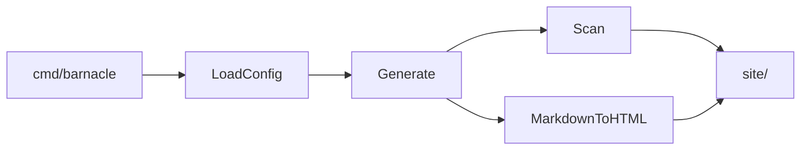

# Command barnacle

The `barnacle` command turns the Markdown and Mermaid files that live alongside source code into a static, interconnected website.

## Flags

| Flag              | Description                                                   |
| ----------------- | ------------------------------------------------------------- |
| `--config <path>` | Configuration file. Defaults to `./.barnacle.json`.           |
| `--site <path>`   | Output directory. Defaults to `./site`.                       |
| `--version`       | Print the version (stamped at build time) and exit.           |
| `--help`          | Show usage and exit (exit code `2`, like other usage errors). |

`--config` changes only where the configuration is read from; the repository root is always the current working directory, and the scan starts there. Relative `--config` and `--site` paths are resolved against it.

## Exit codes

- `0` — success.
- `1` — runtime failure (unreadable or invalid config, scan/render error, unwritable output).
- `2` — usage error (unknown flag, unexpected positional argument, `--help`).

`version` is `dev` unless stamped by the release scripts (`-ldflags "-X main.version=<v>"`, see `scripts/version.sh` and `scripts/release.sh`).

## Related pages

- [internal/barnacle/README.md](../../internal/barnacle/README.md) — the package that does the work
- [Configuration](../../internal/barnacle/config.md) — how `.barnacle.json` is loaded
- [The scanner](../../internal/barnacle/scan.md) — how documentation files are discovered
- [The site generator](../../internal/barnacle/site.md) — how the output is assembled
