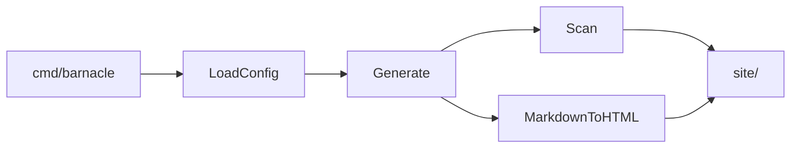

# Command barnacle

The `barnacle` command turns the Markdown and Mermaid files that live alongside source code into a static, interconnected website.

## Flags

| Flag              | Description                                         |
| ----------------- | --------------------------------------------------- |
| `--config <path>` | Configuration file. Defaults to `./.barnacle.json`. |
| `--site <path>`   | Output directory. Defaults to `./site`.             |
| `--version`       | Print the version (stamped at build time) and exit. |
| `--help`          | Show usage and exit.                                |

## Exit codes

- `0` — success.
- `1` — runtime failure (unreadable config, scan or render error).
- `2` — usage error (unknown flag, unexpected argument).

The repository root is always the current working directory; `--config` only changes where the configuration is read from. See [the scanner](../../internal/barnacle/scan.md) for how documentation files are discovered and [the site generator](../../internal/barnacle/site.md) for how the output is assembled.
