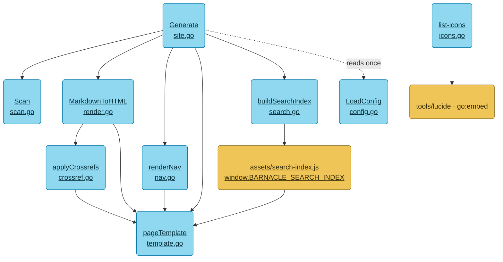

# The `internal/barnacle` package

All of barnacle's implementation lives in this package: configuration, scanning, rendering, cross-references, search indexing, HTML assembly, navigation, and the page template. `cmd/barnacle/main.go.md` is a two-line shim over `Generate` here.

If you want the big picture first, open [cmd/barnacle/main.go.md](../../cmd/barnacle/main.go.md), then [site.go.md](site.go.md). To refresh the pinned helper binaries, see `tools/README.md` (not part of this site); to render this documentation, see [scripts/docs.sh.md](../../scripts/docs.sh.md).

## Pages

- [Configuration — config.go](config.go.md) — `.barnacle.json` loading and validation
- [The scanner — scan.go](scan.go.md) — walk the tree, apply excludes, build `Document`s
- [The renderer — render.go](render.go.md) — goldmark → HTML, link rewriting (including Mermaid `click` directives), Mermaid blocks, SVG inlining
- [Cross-references and captions — crossref.go](crossref.go.md) — pandoc-crossref style figure/table captions, numbering, `@fig:`/`@tbl:` links
- [Client-side search — search.go](search.go.md) — the prebuilt search index and the browser-side search in `assets/app.js`
- [Navigation and landing page — nav.go](nav.go.md) — the sidebar tree and the `index.html` body
- [The page template — template.go](template.go.md) — the HTML shell shared by every page
- [The site generator — site.go](site.go.md) — orchestration: scan → render → write `site/`
- [The icon lister — icons.go](icons.go.md) — the `barnacle list-icons` subcommand: embedded Lucide set + attribution
- [cmd/barnacle/main.go](../../cmd/barnacle/main.go.md) — the process boundary that calls `Generate`

## How the pieces fit

`Generate` ([site.go.md](site.go.md)) is the single entry point: it `Scan`s the tree ([scan.go.md](scan.go.md)), renders each document ([render.go.md](render.go.md) — which numbers captions and rewrites cross-references via [crossref.go.md](crossref.go.md)), builds the navigation tree ([nav.go.md](nav.go.md)), extracts a search index from the rendered pages ([search.go.md](search.go.md)), and executes the shared page template ([template.go.md](template.go.md)) once per page plus the landing page. `LoadConfig` ([config.go.md](config.go.md)) is called once by `main` before `Generate`. `ListIcons` ([icons.go.md](icons.go.md)) is the other public entry point: `main` dispatches `barnacle list-icons` to it instead of `Generate`, so listing the embedded icons never touches the filesystem or the configuration.

## Assets

`assets/barnacle.css` (the site stylesheet, with the light/dark/system theme variables) and `assets/app.js` (the theme toggle cycling System → Light → Dark and the client-side search) are embedded with `go:embed` (`assetsFS` in [site.go.md](site.go.md)) and written into the output on every generation, as is `assets/mermaid.min.js` (the Mermaid renderer, copied only on pages that contain a diagram). `assets/search-index.js` is not embedded — it is generated per site from the rendered pages and assigns `window.BARNACLE_SEARCH_INDEX` (see [search.go.md](search.go.md)). The Lucide icon set is embedded the same way (`tools/lucide/lucide.go`) and inlined into pages at render time (and into the page shell for the theme toggle); `[icons.go](icons.go.md)` exposes the set to `barnacle list-icons`.

## Testing

Tests live next to the code as `*_test.go` (`config_test.go`, `render_test.go`, `crossref_test.go`, `search_test.go`, `site_test.go`) and use only the standard `testing` package. Run them with `go test ./...` (see the README's "Building from source").
