# The `internal/barnacle` package

```mermaid
flowchart TD
    Generate["<span style='position:relative;display:inline-block'><svg class='label-icon' viewBox='0 0 24 24' width='15' height='15' style='position:absolute;left:-32px;top:-15px' fill='none' stroke='currentColor' stroke-width='1.9' stroke-linecap='round' stroke-linejoin='round'><path d='M8.5 7 4 12l4.5 5'/><path d='M15.5 7 20 12l-4.5 5'/></svg><svg class='label-icon' viewBox='0 0 24 24' width='12' height='12' style='position:absolute;right:-31px;top:-14px' fill='none' stroke='currentColor' stroke-width='2.4' stroke-linecap='round' stroke-linejoin='round'><path d='M10 14a5 5 0 0 0 7.07 0L20.6 10.4a5 5 0 0 0-7.07-7.07l-2 2'/><path d='M14 10a5 5 0 0 0-7.07 0L3.4 13.6a5 5 0 0 0 7.07 7.07l2-2'/></svg>Generate<br/>site.go</span>"] --> Scan["<span style='position:relative;display:inline-block'><svg class='label-icon' viewBox='0 0 24 24' width='15' height='15' style='position:absolute;left:-32px;top:-15px' fill='none' stroke='currentColor' stroke-width='1.9' stroke-linecap='round' stroke-linejoin='round'><path d='M8.5 7 4 12l4.5 5'/><path d='M15.5 7 20 12l-4.5 5'/></svg><svg class='label-icon' viewBox='0 0 24 24' width='12' height='12' style='position:absolute;right:-31px;top:-14px' fill='none' stroke='currentColor' stroke-width='2.4' stroke-linecap='round' stroke-linejoin='round'><path d='M10 14a5 5 0 0 0 7.07 0L20.6 10.4a5 5 0 0 0-7.07-7.07l-2 2'/><path d='M14 10a5 5 0 0 0-7.07 0L3.4 13.6a5 5 0 0 0 7.07 7.07l2-2'/></svg>Scan<br/>scan.go</span>"]
    Generate --> Render["<span style='position:relative;display:inline-block'><svg class='label-icon' viewBox='0 0 24 24' width='15' height='15' style='position:absolute;left:-32px;top:-15px' fill='none' stroke='currentColor' stroke-width='1.9' stroke-linecap='round' stroke-linejoin='round'><path d='M8.5 7 4 12l4.5 5'/><path d='M15.5 7 20 12l-4.5 5'/></svg><svg class='label-icon' viewBox='0 0 24 24' width='12' height='12' style='position:absolute;right:-31px;top:-14px' fill='none' stroke='currentColor' stroke-width='2.4' stroke-linecap='round' stroke-linejoin='round'><path d='M10 14a5 5 0 0 0 7.07 0L20.6 10.4a5 5 0 0 0-7.07-7.07l-2 2'/><path d='M14 10a5 5 0 0 0-7.07 0L3.4 13.6a5 5 0 0 0 7.07 7.07l2-2'/></svg>MarkdownToHTML<br/>render.go</span>"]
    Generate --> Nav["<span style='position:relative;display:inline-block'><svg class='label-icon' viewBox='0 0 24 24' width='15' height='15' style='position:absolute;left:-32px;top:-15px' fill='none' stroke='currentColor' stroke-width='1.9' stroke-linecap='round' stroke-linejoin='round'><path d='M8.5 7 4 12l4.5 5'/><path d='M15.5 7 20 12l-4.5 5'/></svg><svg class='label-icon' viewBox='0 0 24 24' width='12' height='12' style='position:absolute;right:-31px;top:-14px' fill='none' stroke='currentColor' stroke-width='2.4' stroke-linecap='round' stroke-linejoin='round'><path d='M10 14a5 5 0 0 0 7.07 0L20.6 10.4a5 5 0 0 0-7.07-7.07l-2 2'/><path d='M14 10a5 5 0 0 0-7.07 0L3.4 13.6a5 5 0 0 0 7.07 7.07l2-2'/></svg>renderNav<br/>nav.go</span>"]
    Generate --> Template["<span style='position:relative;display:inline-block'><svg class='label-icon' viewBox='0 0 24 24' width='15' height='15' style='position:absolute;left:-32px;top:-15px' fill='none' stroke='currentColor' stroke-width='1.9' stroke-linecap='round' stroke-linejoin='round'><path d='M8.5 7 4 12l4.5 5'/><path d='M15.5 7 20 12l-4.5 5'/></svg><svg class='label-icon' viewBox='0 0 24 24' width='12' height='12' style='position:absolute;right:-31px;top:-14px' fill='none' stroke='currentColor' stroke-width='2.4' stroke-linecap='round' stroke-linejoin='round'><path d='M10 14a5 5 0 0 0 7.07 0L20.6 10.4a5 5 0 0 0-7.07-7.07l-2 2'/><path d='M14 10a5 5 0 0 0-7.07 0L3.4 13.6a5 5 0 0 0 7.07 7.07l2-2'/></svg>pageTemplate<br/>template.go</span>"]
    Render --> Template
    Nav --> Template
    Generate -.->|reads once| Config["<span style='position:relative;display:inline-block'><svg class='label-icon' viewBox='0 0 24 24' width='15' height='15' style='position:absolute;left:-32px;top:-15px' fill='none' stroke='currentColor' stroke-width='1.9' stroke-linecap='round' stroke-linejoin='round'><path d='M8.5 7 4 12l4.5 5'/><path d='M15.5 7 20 12l-4.5 5'/></svg><svg class='label-icon' viewBox='0 0 24 24' width='12' height='12' style='position:absolute;right:-31px;top:-14px' fill='none' stroke='currentColor' stroke-width='2.4' stroke-linecap='round' stroke-linejoin='round'><path d='M10 14a5 5 0 0 0 7.07 0L20.6 10.4a5 5 0 0 0-7.07-7.07l-2 2'/><path d='M14 10a5 5 0 0 0-7.07 0L3.4 13.6a5 5 0 0 0 7.07 7.07l2-2'/></svg>LoadConfig<br/>config.go</span>"]
    click Generate href "site.go.md"
    click Scan href "scan.go.md"
    click Render href "render.go.md"
    click Nav href "nav.go.md"
    click Template href "template.go.md"
    click Config href "config.go.md"
    class Generate,Scan,Render,Nav,Template,Config goFile
    classDef goFile fill:#8fd8ef,stroke:#0277a8,color:#08303d
```

All of barnacle's implementation lives in this package: configuration, scanning, rendering, HTML assembly, navigation, and the page template. `cmd/barnacle/main.go.md` is a two-line shim over `Generate` here.

If you want the big picture first, open [cmd/barnacle/main.go.md](../../cmd/barnacle/main.go.md), then [site.go.md](site.go.md). To refresh the pinned helper binaries, see `tools/README.md` (not part of this site); to render this documentation, see [scripts/docs.sh.md](../../scripts/docs.sh.md).

## Pages

- [Configuration — config.go](config.go.md) — `.barnacle.json` loading and validation
- [The scanner — scan.go](scan.go.md) — walk the tree, apply excludes, build `Document`s
- [The renderer — render.go](render.go.md) — goldmark → HTML, link rewriting (including Mermaid `click` directives), Mermaid blocks
- [Navigation and landing page — nav.go](nav.go.md) — the sidebar tree and the `index.html` body
- [The page template — template.go](template.go.md) — the HTML shell shared by every page
- [The site generator — site.go](site.go.md) — orchestration: scan → render → write `site/`
- [cmd/barnacle/main.go](../../cmd/barnacle/main.go.md) — the process boundary that calls `Generate`

## How the pieces fit

`Generate` ([site.go.md](site.go.md)) is the single entry point: it `Scan`s the tree ([scan.go.md](scan.go.md)), renders each document ([render.go.md](render.go.md)), builds the navigation tree ([nav.go.md](nav.go.md)), and executes the shared page template ([template.go.md](template.go.md)) once per page plus the landing page. `LoadConfig` ([config.go.md](config.go.md)) is called once by `main` before `Generate`.

## Assets

`assets/barnacle.css` (the site stylesheet) and `assets/mermaid.min.js` (the Mermaid renderer, copied into `assets/` only on pages that contain a diagram) are embedded with `go:embed` (`assetsFS` in [site.go.md](site.go.md)) and written into the output on every generation.

## Testing

Tests live next to the code as `*_test.go` (`config_test.go`, `render_test.go`, `site_test.go`) and use only the standard `testing` package. Run them with `go test ./...` (see the README's "Building from source").
