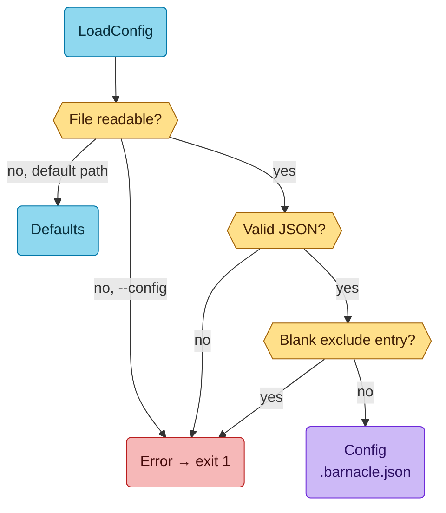

# Configuration (`config.go`)

`LoadConfig` reads and validates the repository-level configuration file (`.barnacle.json`) and produces the `Config` value the rest of the pipeline uses.

## The `Config` struct

- `Title` — shown in the sidebar, the landing page, and page titles. Defaults to the base name of the repository root; `.`, a bare separator, or empty falls back to `Documentation`.
- `Exclude` — directories or files to skip. An entry without a slash matches the base name of every path on the walk; an entry with a slash is matched as a glob against the slash-separated path relative to the root, and everything beneath it is skipped too. An empty exclusion entry is a config error. (`**` is not supported; use `docs/archive` to skip a directory.)
- `IncludeHidden` — allow scanning dot-directories and dot-files other than `.git`, which is always excluded.
- `WarnMissingMermaid` — `*bool`; `warnMissingMermaid` in JSON. Controls the non-fatal note barnacle prints listing pages that contain no Mermaid diagram. Unset or `true` enables it; `false` silences it (see `MermaidWarningEnabled`). Missing diagrams are never an error.

`defaultExcludes` always skips `.git`, `node_modules`, `vendor`, and `dist`, on top of anything configured here.

## Loading semantics

`LoadConfig(path, explicit, root)` has two failure modes on purpose. A missing file at the _default_ location is not an error — defaults are returned (`Config{Title: <root base name>}`). A missing or unreadable file at an _explicitly requested_ path (`--config`) is an error, as is invalid JSON or a blank exclusion entry. A blank `title` in the file falls back to the default title.

The configuration is read once at startup; `root` is always the current working directory — `--config` only changes where the file is read from.

## Where it is used

`cmd/barnacle/main.go.md` calls `LoadConfig`; the resulting `Config` flows into `Generate` (page titles) and `Scan` (exclusions and hidden-file policy). See [the scanner](scan.go.md) and [the site generator](site.go.md).

## Related pages

- [The scanner](scan.go.md) — consumes `Exclude` and `IncludeHidden`
- [The site generator](site.go.md) — consumes `Title` for the landing page
- [The page template](template.go.md) — what ends up on screen
- [README.md](README.md) — package hub
- [cmd/barnacle/main.go.md](../../cmd/barnacle/main.go.md) — calls `LoadConfig` at startup
