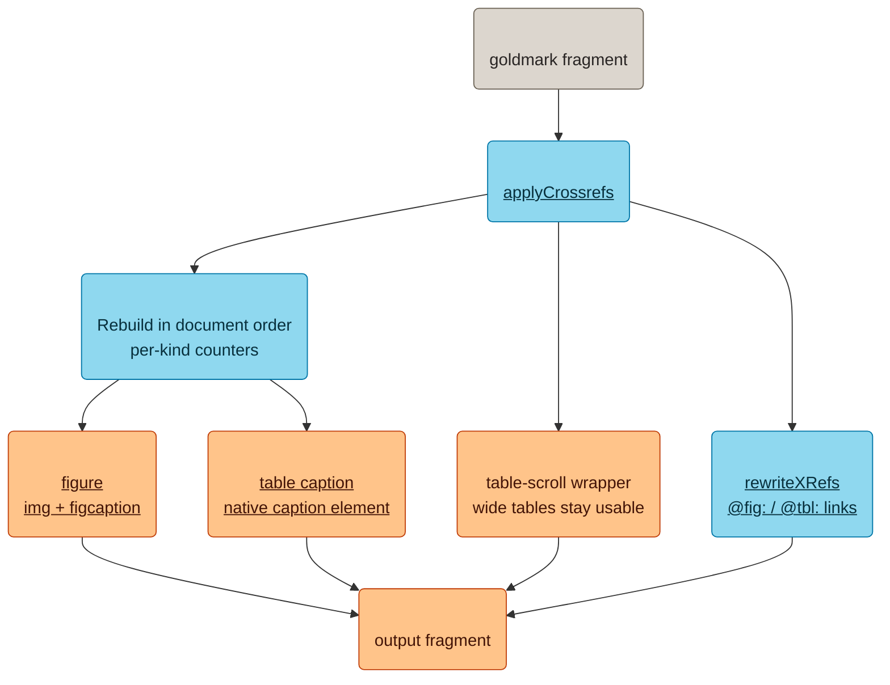

# Cross-references and captions (`crossref.go`)



`crossref.go` implements pandoc-crossref-style captions and cross-references. Every captioned object is numbered per page, in document order; labels are optional and only exist so cross-references can point at them.

## Syntax

```markdown
{#fig:pipeline}

| Stage  | Time |
| ------ | ---- |
| scan   | 12ms |
| render | 40ms |

: Render timings {#tbl:timings}

See @fig:pipeline and @tbl:timings.
```

## Figures

A paragraph containing **nothing but an image** whose definition is immediately followed by `{#fig:label}` becomes:

```html
<figure class="figure" id="fig:pipeline">
  
  <figcaption>
    <span class="caption-label">Figure 1:</span> Compile pipeline
  </figcaption>
</figure>
```

- The caption is the image alt text, HTML-unescaped and re-escaped for output. A caption is required for the image to become a figure — a plain standalone image with no `{#fig:label}` renders exactly as before (barnacle deliberately does not adopt pandoc's implicit-figures behavior).
- Image block and label cannot be separated by spaces (same rule as pandoc-crossref).
- The `<figure>` element carries the label as its `id`, which is what cross-references link to.

## Tables

A table immediately followed by a one-line paragraph starting with `:` takes that line as its caption:

- `: Caption text` — numbered caption, no label;
- `: Caption text {#tbl:label}` — numbered caption, label attached (tagged table renders with `id="tbl:label"`).

The caption becomes a native `<caption>` element, inserted as the first child of the `<table>`; the caption body passes through as inline HTML, so backtick code in captions renders as code. Every `<table>` — captioned or not — is wrapped in `<div class="table-scroll">` (`overflow-x: auto`), so an unbreakable wide table scrolls horizontally on small screens instead of widening the page; cells themselves wrap (`overflow-wrap: break-word`).

## Numbering

Figures and tables are numbered independently per page, in document order (Figure 1, Figure 2, …; Table 1, Table 2, …). A caption gets a number whether or not it carries a label. Labels must be unique per page — a duplicate (of any kind, figure or table) **fails the page render** with an error naming the label and both kinds involved, rather than silently mis-linking references.

## Cross-references

In prose, `@fig:label` and `@tbl:label` (also bracketed: `[@fig:pipeline]`, `[@tbl:timings]`) are replaced with a same-page link to the numbered element:

```html
<a class="xref" href="#fig:pipeline">Figure 1</a>
```

- The link text is the kind word plus the number (`Figure 1`, `Table 2`); pandoc-crossref's `fig.`/`tbl.` prefixes and prefix customization are intentionally not implemented — barnacle keeps one simple default.
- References to unknown labels are left as literal `@fig:…` text. References inside `<pre>`, `<code>` and inside tags are never rewritten (the xref pass walks the fragment outside protected segments and re-emits them verbatim), and an `@` preceded by a word character (an e-mail address) does not match.
- Sentence-final periods are safe: the label charset excludes `.`, so `@fig:pipeline.` parses as the reference plus the period.

## The pipeline

`applyCrossrefs` runs as the last-but-one step of `MarkdownToHTML` — after goldmark, mermaid-block conversion and link rewriting, **before** `inlineLocalSVGs`: figures are an ``-shaped pattern, and inlined SVGs would no longer match it. Its passes:

1. Collect figure and table-caption matches (positions in the fragment), check label uniqueness, sort by document order, assign per-kind numbers in one pass.
2. Rebuild the fragment, substituting the caption blocks (`renderFigureCaption`, `renderTableCaption`).
3. Wrap every `<table>` in `<div class="table-scroll">`.
4. Rewrite cross-references against the assigned numbers.

The pass is regex-based like the rest of the package (there is no goldmark AST dependency); the patterns cannot match inside `<pre>`/`<code>` because the Markdown renderer entity-escapes those regions. Duplicate detection is the only hard error; everything else is best-effort and leaves output untouched when it does not apply.

## Testing

`crossref_test.go` covers per-kind numbering, order of captions, label/duplicate handling, bold escaping, code protection, e-mail lookalikes, unknown labels, tables without labels, inline code in captions, the `table-scroll` wrapper, and the figure-then-inline ordering with local SVG files (the caption pass runs before `inlineLocalSVGs`, so an `{#fig:label}` on a local `.svg` image still produces a figure).

## Related pages

- [The renderer](render.go.md) — the pipeline `applyCrossrefs` plugs into
- [The site generator](site.go.md) — executes the render per page
- [The page template](template.go.md) — the shell the fragment lands in
- [README.md](README.md) — package hub
