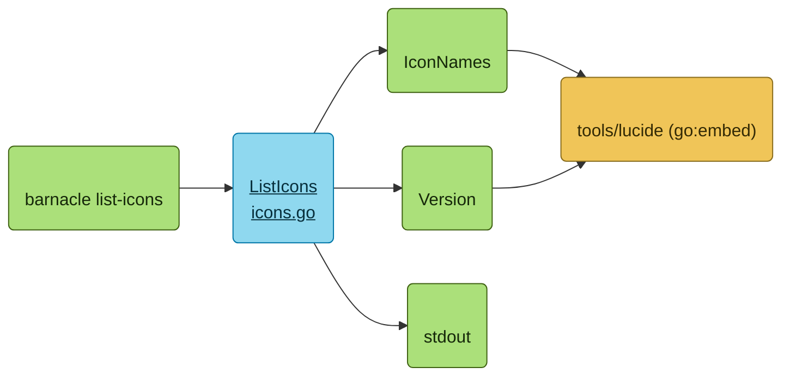

# The icon lister (`barnacle list-icons`)



`ListIcons(w io.Writer)` is the implementation behind `barnacle list-icons`: it writes the sorted list of every Lucide icon embedded in the binary (one per line) to `w`, framed by a header and a trailing attribution block.

`cmd/barnacle/main.go` dispatches the `list-icons` subcommand to it before any flag parsing, so the subcommand never builds a `flag.FlagSet`, never scans a repository, and never writes a site. `barnacle list-icons --bogus` is a usage error (exit code `2`); a failure to read the embedded set is a runtime error (exit code `1`).

## Output shape

```text
barnacle — 2055 icons from Lucide v1.73.0 (https://lucide.dev)

<one icon name per line, sorted>

The icons above are Lucide v1.73.0 (https://lucide.dev), © Lucide Icons and contributors.
Lucide is ISC-licensed; the Feather-derived icons retain their MIT License.
The full license text is embedded in this binary and is also shipped next
to every release binary (LUCIDE-LICENSE) and in every release archive.
https://lucide.dev · source: https://github.com/lucide-icons/lucide
```

The header reports the embedded set's size and pinned version; the bare name list is deliberately one-name-per-line so it pipes cleanly into `grep`, `wc -l` and friends.

**The attribution block is the point of the subcommand as much as the list is**: the icons are [Lucide](https://lucide.dev), © Lucide Icons and contributors, ISC-licensed (the Feather-derived section retains the MIT License). The full text lives in the binary itself (embedded from `tools/lucide/LICENSE`) and ships next to every release binary as `LUCIDE-LICENSE` (see [`scripts/build.sh.md`](../../scripts/build.sh.md) and [`scripts/release.sh.md`](../../scripts/release.sh.md)), but the credit also belongs in the tool's own output — `list-icons` is where a user discovers the set exists, so that is where the link and the license mention go.

The embedded set comes from `tools/lucide` (`lucide.go`) via `go:embed`; the names, the license text and the vendored `VERSION` are all read out of that package. There is no runtime dependency on the repository layout — a barnacle built years ago still lists its pinned set.

## Related pages

- [The renderer](render.go.md) — inlines these icons through the `barnacle:<name>.svg` shorthand
- `tools/lucide/lucide.go` — the embedded set, license and version (not part of this site)
- [cmd/barnacle/main.go](../../cmd/barnacle/main.go.md) — the subcommand dispatch and exit codes
- [README.md](README.md) — package hub
