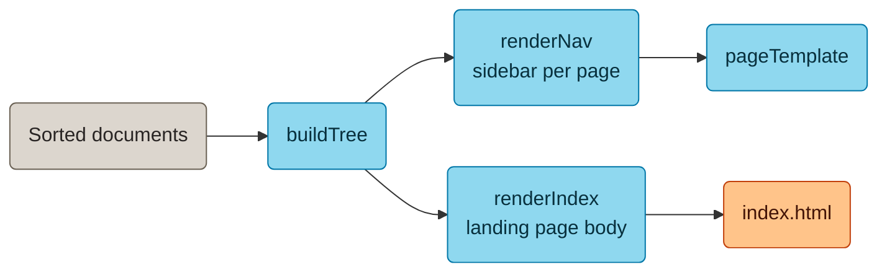

# Navigation and landing page (`nav.go`)

`nav.go` renders the sidebar navigation and the body of the landing page `index.html`. Both are built from the same directory tree derived from the scanned documents.

## `buildTree`

`buildTree(docs []Document) *treeNode` splits each document's `RelPath` on `/` and inserts it into a tree of `treeNode` values (`name`, `isDir`, `doc`, `children`). Directory and file names that collide on one segment are separate nodes (`isDir` disambiguates). Documents are already sorted by `RelPath` when they reach `buildTree`, so the tree — and everything rendered from it — is deterministic.

## `renderNav`

Renders the sidebar as nested `<ul class="nav-tree">` lists. Links are relative to the page being rendered (`currentOutRel`, slash-separated from the site root), computed with `relativeURL` from [site.go.md](site.go.md). The link for the current page gets `aria-current="page"` and the `current` class; directory entries are plain `` labels, not links.

## `renderIndex`

Renders the landing page body: the site title as `<h1>`, a short explainer sentence, and a `<ul class="doc-index">` of every page — each with its source path as a `doc-path` span. With no documents it emits an `empty-state` paragraph telling the user to add `.md`/`.mmd` files and re-run barnacle.

## Where it is used

`Generate` in [site.go.md](site.go.md) calls `buildTree` once, then `renderNav` per page (and once for `index.html`) and `renderIndex` for the landing page body. The output HTML is injected into the page shell as `template.HTML` — see [the page template](template.go.md).

## Related pages

- [The scanner](scan.go.md) — the `Document` list `buildTree` consumes
- [The site generator](site.go.md) — calls these renderers and supplies `relativeURL`
- [The page template](template.go.md) — the shell the nav and index are injected into
- [README.md](README.md) — package hub
