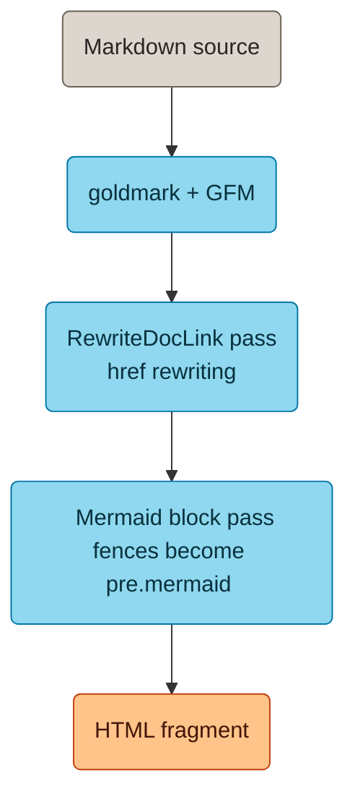

# Renderer



Markdown is rendered to HTML with [goldmark](https://github.com/yuin/goldmark) (GFM: tables, strikethrough, task lists, autolinked URLs), plus two post-processing passes.

## Link rewriting

`RewriteDocLink` rewrites only _relative_ link destinations whose path ends in `.md`, `.markdown`, or `.mmd` (case-insensitive), replacing the extension with `.html`. Fragments and query strings are preserved. Absolute URLs (`https://…`, `mailto:…`), protocol-relative URLs, and pure `#fragment` links are left untouched. Because the generated site mirrors the source directory layout, no path arithmetic is needed — only the extension changes. `MarkdownToHTML` applies this to every `href="…"` in the rendered output via `rewriteDocLinks`.

## Mermaid

Fenced ` ```mermaid ` code blocks become `<pre class="mermaid">` elements, which mermaid.js (bundled at `assets/mermaid.min.js`) renders in the browser. Standalone `.mmd` files are placed in a `<pre class="mermaid">` block directly — see [the site generator](site.go.md). The block contents stay HTML-escaped; mermaid reads them via `textContent`, which unescapes the entities.

`HasMermaid` reports whether rendered HTML contains a `<pre class="mermaid">`; `Generate` uses it to decide whether to ship `mermaid.min.js` and to flag the page in the template.

### `click` directives (clickable nodes)

Mermaid flowcharts natively support `click` directives, which make nodes navigable. `rewriteMermaidLinks` rewrites documentation targets (`.md`/`.markdown`/`.mmd`) inside `click` directives to the generated `.html` pages, the same invariant as `RewriteDocLink` — relative targets are resolved against the page URL, and the site mirrors the source tree, so swapping the extension is enough. Tooltips, external URLs and JavaScript callbacks are left alone; blocks are unescaped and re-escaped around the rewrite (`escapeMermaidText`), so entity round-trips are safe. Works in fenced blocks, in hand-authored `<pre class="mermaid">` blocks, and in standalone `.mmd` files (every block is rewritten exactly once). Note: JavaScript callbacks (`click A callback`, `click A call fn()`) require Mermaid's `securityLevel: 'loose'`, which barnacle does not enable — node navigation via `href` works under `strict`, since relative URLs pass Mermaid's sanitizer. For transitions, see "HTML in diagram labels" below.

### HTML in diagram labels (clickable transitions)

Mermaid has no edge-`click` grammar, but edge labels render as real HTML inside the SVG (mermaid's `htmlLabels` mode, under `securityLevel: 'strict'`, through DOMPurify — relative URLs pass, `javascript:` is stripped). So an inline anchor in a label renders as a clickable HTML link, and barnacle rewrites its target like everything else:

```text
Idle --> Waiting : <a href="dispatch.md">send(cmd)</a>
Aim   --> Launch : <a href="launch.md" title="Launch sequence">go</a>
```

Mechanics:

- Every `href="..."` token in the block is rewritten to `.html` when it ends in `.md`/`.markdown`/`.mmd` (case-insensitive), fragments and query strings preserved — the same invariant as Markdown links and node `click` directives. In the rendered output, `&quot;`-escaping is applied/unapplied around the pass so attribute quotes round-trip cleanly.
- Attributes the author puts inside the anchor (`title`, `target="_blank"`, fragments, …) pass through DOMPurify untouched in `strict`.
- Mermaid's own quirks apply to the source syntax: state diagrams cannot contain `:` in transition text; flowchart labels with parentheses must be quoted (`-->|"<a href='x.md'>send(cmd)</a>"|`), using single quotes inside the double-quoted label.
- Node `click` directives keep working; inline anchors are for transitions and inline marks.

## Local SVG inlining

Barnacle rewrites `` tags whose destination is a relative `.svg` path to **data URIs** at generation time, so diagrams (and body content) can inline real icon files without any external requests — sites stay fully self-contained and work from any base URL. This repository uses the vendored [Lucide](https://lucide.dev) icon set living in `tools/lucide/` for its own diagram icons.

The rules:

- Only relative `.svg` destinations are inlined (case-insensitive), resolved against the **document's own directory** — a reference must resolve beneath the repository root, or the page fails to render with an error naming the path and the page.
- External URLs, `data:` URIs, protocol-relative URLs, fragments and anything else are left untouched.
- Missing or unreadable files fail the render (`Fail loudly`).
- Only `.svg` is handled; the bytes are base64-wrapped into `data:image/svg+xml;base64,…`, which also sidesteps every escaping concern at the HTML and Mermaid layers — `strict` securityLevel is unaffected, no new tags or attributes are introduced.
- It applies to Markdown content and to Mermaid diagrams alike (diagram labels may reference an icon file; e.g. ``), and to standalone `.mmd` pages.
- `MarkdownToHTML` and `MermaidPageHTML` take a `RenderContext{SourceDir, Root}` identifying the source file's directory and the repository root. Passing the zero context leaves `` tags untouched — useful for tests and callers that render detached content.

This is how the icons in this repository's own diagrams appear in the browser with no network requests: the generator reads each `` from disk and bakes its bytes into the page.

## Related pages

- [The scanner](scan.go.md) — finds the `.md`/`.mmd` files this renderer turns into pages
- [The site generator](site.go.md) — calls `MarkdownToHTML` / `MermaidPageHTML` per page
- [The page template](template.go.md) — injects the fragment and loads mermaid.js when needed
- [README.md](README.md) — package hub
