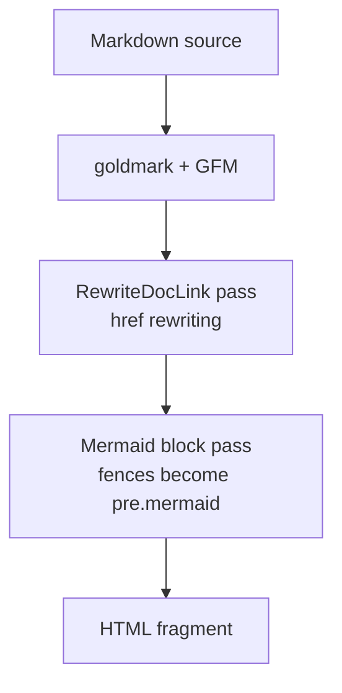

# Renderer



Markdown is rendered to HTML with [goldmark](https://github.com/yuin/goldmark) (GFM: tables, strikethrough, task lists, autolinked URLs), plus two post-processing passes.

## Link rewriting

`RewriteDocLink` rewrites only _relative_ link destinations whose path ends in `.md`, `.markdown`, or `.mmd` (case-insensitive), replacing the extension with `.html`. Fragments and query strings are preserved. Absolute URLs (`https://…`, `mailto:…`), protocol-relative URLs, and pure `#fragment` links are left untouched. Because the generated site mirrors the source directory layout, no path arithmetic is needed — only the extension changes. `MarkdownToHTML` applies this to every `href="…"` in the rendered output via `rewriteDocLinks`.

## Mermaid

Fenced ` ```mermaid ` code blocks become `<pre class="mermaid">` elements, which mermaid.js (bundled at `assets/mermaid.min.js`) renders in the browser. Standalone `.mmd` files are placed in a `<pre class="mermaid">` block directly — see [the site generator](site.go.md). The block contents stay HTML-escaped; mermaid reads them via `textContent`, which unescapes the entities.

`HasMermaid` reports whether rendered HTML contains a `<pre class="mermaid">`; `Generate` uses it to decide whether to ship `mermaid.min.js` and to flag the page in the template.

`HasEdgeLinks` reports whether rendered HTML contains a `class="barnacle-edge-links"` manifest (i.e. a diagram used `%% barnacle: link`); `Generate` uses it to ship `barnacle-edges.js` and to flag the page in the template.

### `click` directives (clickable nodes)

Mermaid flowcharts natively support `click` directives, which make nodes navigable. `rewriteMermaidLinks` rewrites documentation targets (`.md`/`.markdown`/`.mmd`) inside `click` directives to the generated `.html` pages, the same invariant as `RewriteDocLink` — relative targets are resolved against the page URL, and the site mirrors the source tree, so swapping the extension is enough. Tooltips, external URLs and JavaScript callbacks are left alone; blocks are unescaped and re-escaped around the rewrite (`escapeMermaidText`), so entity round-trips are safe. works in fenced blocks, in hand-authored `<pre class="mermaid">` blocks, and in standalone `.mmd` files (every block is rewritten exactly once). Note: JavaScript callbacks (`click A callback`, `click A call fn()`) require Mermaid's `securityLevel: 'loose'`, which barnacle does not enable — node navigation via `href` works under `strict`, since relative URLs pass Mermaid's sanitizer. Edges are not clickable (Mermaid has no grammar for it); see the README's "Proposed: clickable edges".

Both passes operate on the rendered HTML, which keeps the code small and predictable.

### Edge links (`%% barnacle: link`)

Mermaid cannot click edges natively, so barnacle wires them itself. An author drops a comment directive into any diagram:

```text
%% barnacle: link <key> href "<target>" ["<tooltip>"] [_blank]
```

- **`<key>` (bare)** matches the edge's `data-id` — the explicit `e1` from `A e1@--> B`, or the auto-assigned id of any unnamed edge (`edge0`, `edge1`, … in state diagrams; `L_A_B_0` in unnamed flowcharts).
- **`<key>` (quoted)** matches the edge's label text — `%% barnacle: link "send(cmd)" href "api.go.md"` makes the `send(cmd)` transition clickable.
- `.md`/`.markdown`/`.mmd` targets are rewritten to `.html` by the same `RewriteDocLink` invariant as everything else in this file; fragments, queries, external URLs and everything else pass through untouched; targets are case-insensitive.
- Directives that match no edge log a `console.warn` and leave the diagram untouched — never an error, never a broken build.

At build time `rewriteMermaidLinks` extracts the directives from the mermaid source (the lines stay in place — mermaid renders them as comments), rewrites their targets, and emits a per-diagram JSON manifest right after the `<pre class="mermaid">` block:

```html
<script type="application/json" class="barnacle-edge-links">
  { "edges": [{ "key": "e1", "by": "id", "href": "api.go.html" }] }
</script>
```

In the browser, `assets/barnacle-edges.js` (copied next to `mermaid.min.js` only when a page contains a manifest) observes each processed diagram, pairs it with its adjacent manifest, resolves each key against the SVG — bare keys against `path[data-id]`, quoted keys against `g.label[data-id]` text — and wraps the matching stroke, plus an invisible wide copy of it for a usable hit area, in an SVG `<a>` with `xlink:href`, `tabindex="0"`, `role="link"`, keyboard activation, and a visible focus outline. The resulting anchor is an ordinary link: it navigates on user interaction only, under `securityLevel: 'strict'`, and the E2E suite navigates every page and every anchor it finds (including injected edge anchors) in a real browser on every change.

Like node clicks, the wiring depends on Mermaid's rendered DOM contract (`path[data-id]` / `g.label[data-id]`), which is stable in the bundled mermaid but not a published API — the end-to-end tests catch regressions across mermaid upgrades.

Works in fenced blocks, in hand-authored `<pre class="mermaid">` blocks, and in standalone `.mmd` files.

## Related pages

- [The scanner](scan.go.md) — finds the `.md`/`.mmd` files this renderer turns into pages
- [The site generator](site.go.md) — calls `MarkdownToHTML` / `MermaidPageHTML` per page
- [The page template](template.go.md) — injects the fragment and loads mermaid.js when needed
- [README.md](README.md) — package hub
