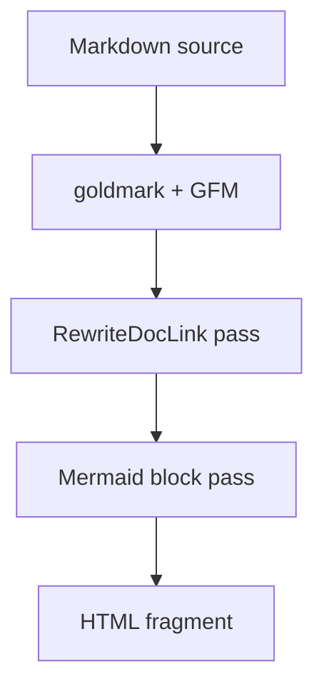

# Renderer

Markdown is rendered to HTML with [goldmark](https://github.com/yuin/goldmark) (GFM: tables, strikethrough, task lists, autolinks), plus three post-processing passes.



## Link rewriting

`RewriteDocLink` rewrites only *relative* link destinations whose path ends in `.md`, `.markdown`, or `.mmd` (any case), replacing the extension with `.html`. Fragments and query strings are preserved. Absolute URLs (`https://…`, `mailto:…`), protocol-relative URLs, and pure `#fragment` links are left untouched. Because the generated site mirrors the source directory layout, no path arithmetic is needed — only the extension changes.

## Mermaid

Fenced ` ```mermaid ` code blocks become `<pre class="mermaid">` elements, which mermaid.js (bundled at `assets/mermaid.min.js`) renders in the browser. Standalone `.mmd` files are placed in a `<pre class="mermaid">` block directly — see [the site generator](site.md).

Both passes operate on the rendered HTML, which keeps the code small and predictable.
