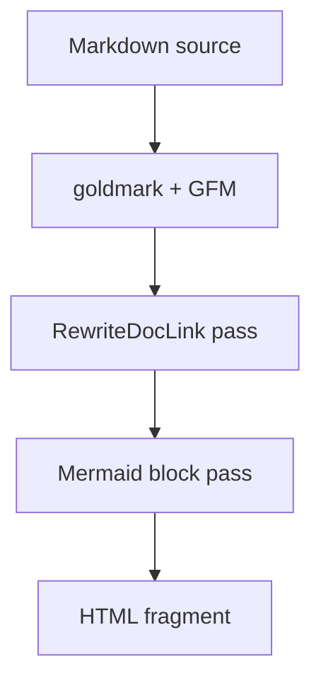

# Renderer

Markdown is rendered to HTML with [goldmark](https://github.com/yuin/goldmark) (GFM: tables, strikethrough, task lists, autolinked URLs), plus two post-processing passes.



## Link rewriting

`RewriteDocLink` rewrites only _relative_ link destinations whose path ends in `.md`, `.markdown`, or `.mmd` (case-insensitive), replacing the extension with `.html`. Fragments and query strings are preserved. Absolute URLs (`https://…`, `mailto:…`), protocol-relative URLs, and pure `#fragment` links are left untouched. Because the generated site mirrors the source directory layout, no path arithmetic is needed — only the extension changes. `MarkdownToHTML` applies this to every `href="…"` in the rendered output via `rewriteDocLinks`.

## Mermaid

Fenced ` ```mermaid ` code blocks become `<pre class="mermaid">` elements, which mermaid.js (bundled at `assets/mermaid.min.js`) renders in the browser. Standalone `.mmd` files are placed in a `<pre class="mermaid">` block directly — see [the site generator](site.md). The block contents stay HTML-escaped; mermaid reads them via `textContent`, which unescapes the entities.

`HasMermaid` reports whether rendered HTML contains a `<pre class="mermaid">`; `Generate` uses it to decide whether to ship `mermaid.min.js` and to flag the page in the template.

Both passes operate on the rendered HTML, which keeps the code small and predictable.

## Related pages

- [The scanner](scan.md) — finds the `.md`/`.mmd` files this renderer turns into pages
- [The site generator](site.md) — calls `MarkdownToHTML` / `MermaidPageHTML` per page
- [The page template](template.md) — injects the fragment and loads mermaid.js when needed
- [README.md](README.md) — package hub
