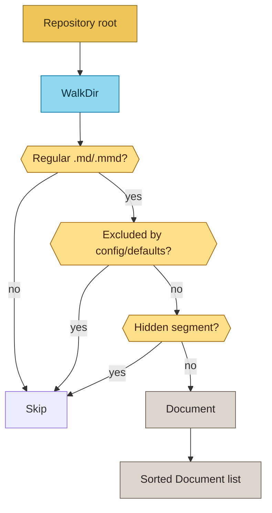

# Scanner

`Scan` walks the repository root and returns every `.md` and `.mmd` file, sorted by slash-separated relative path. The output directory is never scanned.

## Rules

- `.git`, `node_modules`, `vendor`, and `dist` are always excluded.
- Dot-files and dot-directories are skipped unless `includeHidden` is set in the config.
- Additional exclusions come from the `exclude` config list: a bare name matches any path segment; an entry with a slash is matched as a glob against the slash-separated relative path and skips everything beneath it (`**` is not supported — `docs/archive` skips that directory and all of it).
- The output directory (`./site` by default) is skipped during the walk, even though it usually lives inside the root.
- Extensions are matched case-insensitively; only regular files are considered.

## Documents

Each discovered file becomes a `Document`:

- `RelPath` — source path relative to the root (`parser/parser.cpp.md`).
- `OutputRel` — generated page path; the extension is replaced with `.html` (`parser/parser.cpp.md` → `parser/parser.cpp.html`).
- `SourcePath` — absolute path of the file, used to read it later.
- `Title` — the first level-1 ATX heading for `.md` files (with closing hashes trimmed), otherwise the humanized file name (`my-page.md` → `My page`); `.mmd` files always get the humanized name. Falling back to the humanized name when there is no level-1 heading.
- `MermaidOnly` — true for `.mmd` files, which contain nothing but a diagram.

## Where it is used

`Generate` in [the site generator](site.go.md) calls `Scan` first; the returned list drives rendering, the navigation tree, and the collision check (a `.md` and a `.mmd` with the same base name both produce the same `.html`, and `Generate` fails instead of overwriting one).

## Related pages

- [The site generator](site.go.md) — calls `Scan` and consumes `Document`
- [Configuration](config.go.md) — supplies `Exclude` and `IncludeHidden`
- [The renderer](render.go.md) — turns the scanned files into HTML
- [Navigation and landing page](nav.go.md) — builds the tree from the scanned list
- [README.md](README.md) — package hub
