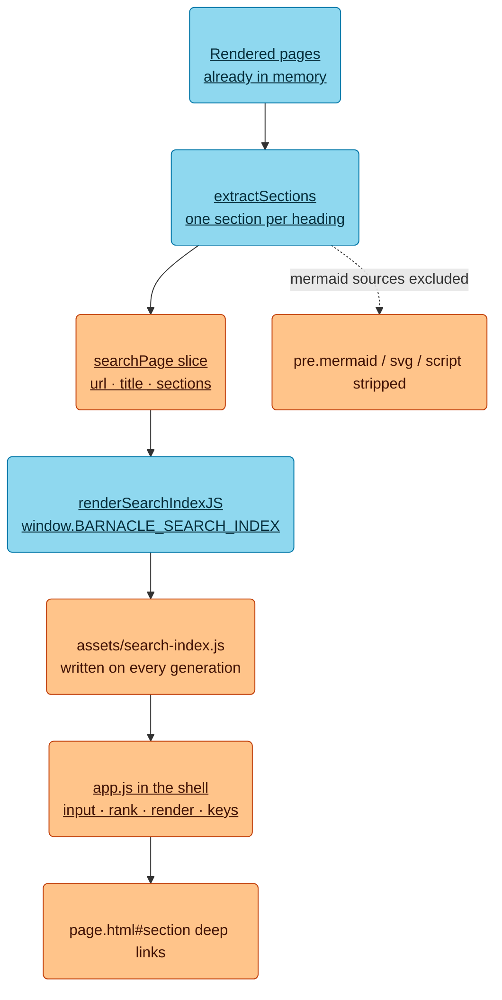

# Client-side search (`search.go`)

`search.go` builds barnacle's search index. Barnacle is a static site with no server, so search happens entirely in the browser against a prebuilt index — one `<script src>` per page, no fetch (which `file://` pages cannot use), no service worker, no external service.

## Building the index

`Generate` already holds every rendered page in memory; `buildSearchIndex` walks them and extracts, per page:

- `u` — the site-root-relative URL (`guide/usage.html`), path-escaped per segment like the nav links;
- `t` — the page title (the `#` heading, or the humanized file name);
- `s` — sections: one per heading (`<h1 id>`…`<h6 id>` split), each with `a` (the anchor id from `WithAutoHeadingID`), `t` (heading text) and `x` (body plain text until the next heading).

The body before the first heading becomes one implicit section keyed to the page title (only when it contains text). Section text is capped at 3000 characters — enough for a typical section, and it bounds the index size on huge pages. Mermaid sources (`<pre class="mermaid">`), inlined `<svg>`s and `<script>/<style>` elements are excluded: searching diagram source is noise, not signal. Everything else — prose, inline code, code blocks — is searchable; tags are stripped and entities unescaped.

## The index file

`renderSearchIndexJS` serializes the slice as an external JavaScript file that assigns `window.BARNACLE_SEARCH_INDEX`. It is written to `assets/search-index.js` on every generation (next to the embedded assets, but generated — not embedded), and every page loads it with `<script defer src="…/assets/search-index.js">` **before** `assets/app.js`. A plain script tag works from `file://`, which is exactly why the index is not fetched as JSON.

## The client (`assets/app.js`)

The same `app.js` also wires the theme toggle; the search side:

- each page gets a search box at the top of the sidebar (`#barnacle-search`) plus a results dropdown (`#search-results`, `role="listbox"`); every visible result is an `<a role="option" href="page.html#anchor">`, keyboard-activatable; page titles in results render Markdown inline code as `<code>` (see [nav.go.md](nav.go.md));
- queries are tokenized on whitespace; **all** terms must appear (case-insensitive substring) in the page blob (title + section texts), then:
  - page-level: title hits score +20 per term;
  - section-level: +10 per term in the heading, plus raw occurrence count in the body;
  - results are grouped by page, sorted by total (title + best section), capped at 8 pages × 3 section hits;
- snippets are built around the first match, terms wrapped in `<mark class="search-mark">` (DOM-built, so no markup injection);
- `/` or `Cmd/Ctrl+K` focuses the box from anywhere, `↑`/`↓` move the active hit, `Enter` opens it, `Esc` clears and blurs; clicking elsewhere (focusout outside the search container) closes the dropdown;
- the dropdown is absolutely positioned and overlays the nav on desktop; under 800 px the sidebar becomes a static block and the dropdown renders in-flow.

## Why this shape

- No build tooling: hand-written vanilla JS, ~150 lines, like the rest of the site — barnacle stays a single-binary, dependency-light tool.
- No network dependency: the index is as portable as the site itself.
- Predictable cost: O(total index size) per keypress with cheap substring loops — fine up to thousands of sections; the 3000-char section cap keeps it that way.

## Testing

`search_test.go` covers section extraction (heading anchors, implicit leading section, entity unescaping), mermaid exclusion, the 3000-char truncation, URL escaping (`%20`, Windows separators), and the JS payload shape (`window.BARNACLE_SEARCH_INDEX = …`, valid JSON, empty index still emits valid JS). `site_test.go` asserts the generated site writes `assets/app.js` and `assets/search-index.js` and that pages reference both. The browser behavior (dropdown rendering, mark highlighting, keyboard flow) is verified by inspection against the fixture site; the e2e suite (`e2e_test.go`) covers link/anchor resolution for the generated pages.

## Related pages

- [The site generator](site.go.md) — calls `buildSearchIndex` and writes `assets/search-index.js`
- [The page template](template.go.md) — the shell that loads the index and renders the search box
- [The renderer](render.go.md) — produces the fragments the extractor walks
- [README.md](README.md) — package hub
