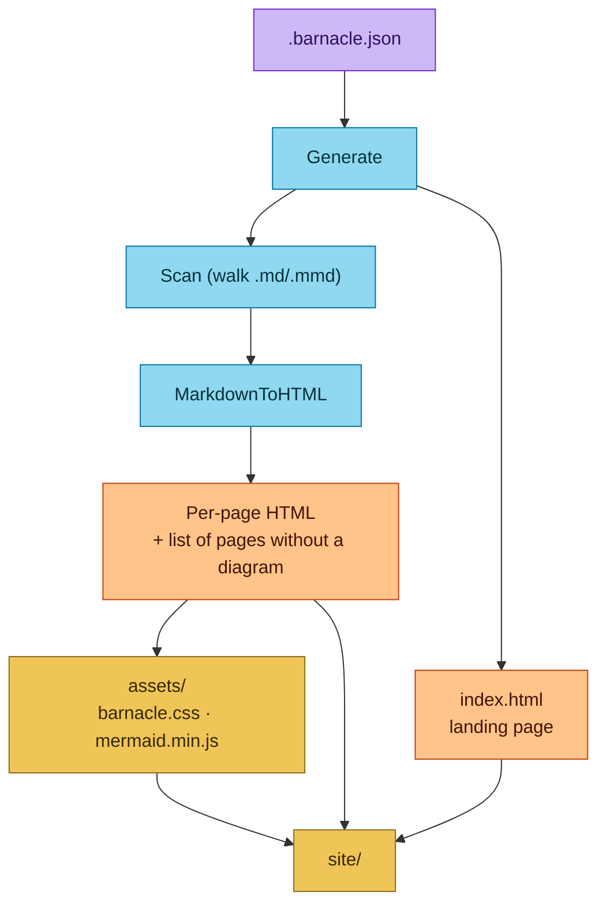

# Site generator

`Generate` builds the static site from the root directory into the output directory.

## Steps

1. **Scan** the root for documentation files (see [the scanner](scan.go.md)).
2. **Render** each file — Markdown to HTML, or `.mmd` into a Mermaid block (see [the renderer](render.go.md)). Pages that contain a Mermaid diagram pull in `assets/mermaid.min.js`. It also collects the relative paths of pages with **no** Mermaid diagram and returns them — the caller (`cmd/barnacle/main.go.md`) prints them as a non-fatal stderr note, never an error.
3. **Prepare** the output directory. If it holds barnacle's `.barnacle-site` marker, it is wiped first so deleted pages disappear; otherwise it is created and barnacle's files are overwritten one by one.
4. **Write** `assets/barnacle.css` (and `mermaid.min.js` when needed), every page, a landing `index.html`, and the marker file.

## Return value

`Generate` returns `(pages int, missingMermaid []string, err error)`. `pages` counts every written page including `index.html`; `missingMermaid` lists the scanned pages whose rendered HTML contains no `<pre class="mermaid">` (standalone `.mmd` pages never qualify — they always contain one). Callers use it for guidance only; the slice never affects the build outcome.

## Pages

Every page is the same shell: a sidebar with a tree of all documented pages (links relative to the page; the current page is marked `aria-current="page"`) plus the page's content. The landing page lists every page with its source path.

Relative links between pages are just relative links between the mirrored directories, so the generated site works from any base URL — open it locally, publish it with GitHub Pages, or host it anywhere static files are served.

`.md`/`.mmd` pairs with the same base name would both produce the same `.html` file, so `Generate` fails with an explicit collision error instead of silently overwriting one of them.

## Where it is used

Called exactly once per run by `main` in [cmd/barnacle/main.go.md](../../cmd/barnacle/main.go.md) — nowhere else. It is the assembly point: everything else in the package is a helper it wires together.

## Related pages

- [The scanner](scan.go.md) — produces the document list
- [The renderer](render.go.md) — renders each document's body
- [Navigation and landing page](nav.go.md) — sidebar and `index.html` body
- [The page template](template.go.md) — the HTML shell every page shares
- [Configuration](config.go.md) — what `Generate` receives as `cfg`
- [README.md](README.md) — package hub
