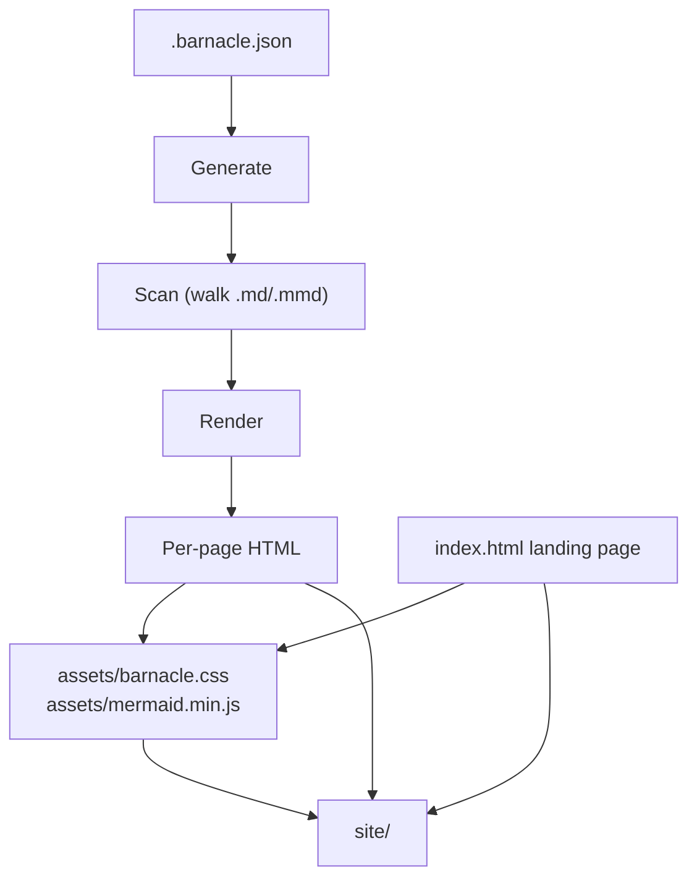

# Site generator

`Generate` builds the static site from the root directory into the output directory.

## Steps

1. **Scan** the root for documentation files (see [the scanner](scan.md)).
2. **Render** each file — Markdown to HTML, or `.mmd` into a Mermaid block (see [the renderer](render.md)). Pages that contain a Mermaid diagram pull in `assets/mermaid.min.js`.
3. **Prepare** the output directory. If it holds barnacle's `.barnacle-site` marker, it is wiped first so deleted pages disappear; otherwise it is created and barnacle's files are overwritten one by one.
4. **Write** `assets/barnacle.css` (and `mermaid.min.js` when needed), every page, a landing `index.html`, and the marker file.

## Pages

Every page is the same shell: a sidebar with a tree of all documented pages (links relative to the page; the current page is marked `aria-current="page"`) plus the page's content. The landing page lists every page with its source path.

Relative links between pages are just relative links between the mirrored directories, so the generated site works from any base URL — open it locally, publish it with GitHub Pages, or host it anywhere static files are served.

`.md`/`.mmd` pairs with the same base name would both produce the same `.html` file, so `Generate` fails with an explicit collision error instead of silently overwriting one of them.
