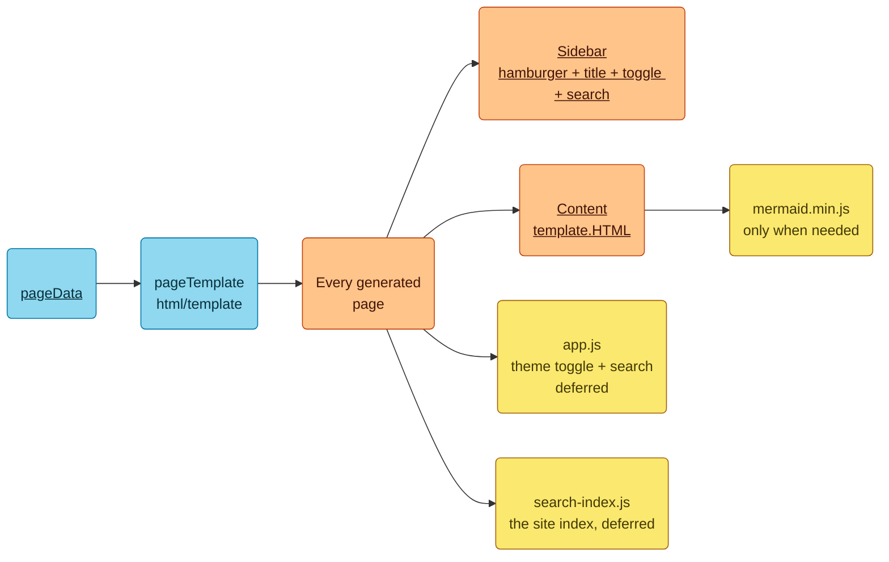

# The page template (`template.go`)

`template.go` holds the single HTML page shell every generated page shares, rendered with `html/template`.

## `pageData`

The template's data:

- `SiteTitle` — from the `.barnacle.json` `title` (see [config.go.md](config.go.md)); shown as the sidebar site title and in `<title>`.
- `PageTitle` — the page's own title (`<title>` and heading content come from the page body itself).
- `Content` — `template.HTML` page body (already-rendered HTML from [render.go.md](render.go.md) or [MermaidPageHTML](render.go.md)), injected verbatim.
- `Nav` — `template.HTML` sidebar navigation from `renderNav` (see [nav.go.md](nav.go.md)).
- `RelPrefix` — `"../"` repeated per level of nesting (`""` for top-level pages, `"../"` for `parser/parser.html`); prefixes the asset URLs so relative links work from any depth. Computed by `relPrefix` in [site.go.md](site.go.md). Also exposed to the search box as `data-prefix`.
- `HasMermaid` — when true, the shell adds `<script src="{{.RelPrefix}}assets/mermaid.min.js">` and calls `mermaid.initialize({ startOnLoad: true, securityLevel: 'strict', theme: … })`, choosing the mermaid theme from the page's effective theme (see below).
- `IconSystem` / `IconLight` / `IconDark` / `IconMenu` / `SearchIcon` — inline Lucide SVGs read once per generation from the embedded set (see [icons.go.md](icons.go.md) and [site.go.md](site.go.md)), so the shell is self-contained exactly like the diagrams. Injected as `template.HTML` — they are trusted, barnacle-written markup. `IconSystem` is Lucide `sun-moon`, `IconLight` is `sun`, `IconDark` is `moon` (one glyph per preference, selected in CSS); `IconMenu` is Lucide `menu` for the sidebar toggle.

## The shell

A fixed `<!DOCTYPE html>` document: `<meta name="generator" content="barnacle">`, an inline **preload script** in `<head>`, the `<title>`, the stylesheet, two deferred scripts (`assets/search-index.js`, then `assets/app.js`), and — on Mermaid pages only — the Mermaid bootstrap. The body is a sidebar `<aside>` and a `<main class="content">` with a footer linking to the barnacle repository. `<title>` is `PageTitle · SiteTitle`, collapsing to just `PageTitle` when the two are equal (the landing page).

Page content is inserted as `template.HTML` — it is trusted HTML produced by the renderer (goldmark with `WithUnsafe`), not user input from the browser. Everything else (titles, nav) is escaped by `html/template` or `html.EscapeString` upstream.

### The preload script and the sidebar toggle

The inline head script runs before first paint: it reads `localStorage['barnacle-theme']` (`system`, `light` or `dark`; anything missing or invalid means `system`) and sets `data-theme` on `<html>`, and it reads `localStorage['barnacle-sidebar']` (`open` by default; only `collapsed` is honored) and sets `data-sidebar` on `<html>` — so a collapsed sidebar never flashes open. The toggle is a hamburger button in the sidebar header (`#sidebar-toggle`, Lucide `menu`) next to the site title and the theme button; `assets/app.js` wires the click: toggles `data-sidebar` between `open` and `collapsed`, persists to localStorage, and syncs `aria-expanded`/`title` (the button always reads "Toggle sidebar" / "Hide sidebar" / "Show sidebar"). On desktop the collapsed sidebar shrinks to a slim 56px rail holding only the hamburger; on mobile it shrinks to its header row (the hamburger and site title stay). The nav tree, search box and theme toggle hide while collapsed, and the grid column animates. `prefers-reduced-motion` disables the transition.

The stylesheet (`assets/barnacle.css`) keeps the light palette on `:root` and swaps in the dark palette two ways — once inside `@media (prefers-color-scheme: dark)` guarded by `:root:not([data-theme="light"])` (for System), once for `:root[data-theme="dark"]` (for explicit Dark) — so `system` needs no attribute-based override, and an explicit choice always wins over the OS. The sidebar stays dark in every theme by design.

### The theme: System / Light / Dark

The toggle is a single icon button in the sidebar header (`#theme-toggle`) showing the Lucide `sun-moon`, `sun` or `moon` glyph for the current preference — selected in pure CSS off `<html data-theme>`, no JS required for the visuals. `assets/app.js` wires the click: System → Light → Dark → System, persists to localStorage, and syncs `aria-label`/`title` (e.g. "Theme: System — activate to change"). When the page has Mermaid, the bootstrap script computes the effective theme the same way and initializes Mermaid with `theme: 'dark'` or `theme: 'default'`, so diagrams don't flash dark-on-light.

### The search box

Below the sidebar header, a search box (`#barnacle-search`, `role="search"`, `aria-expanded`/`aria-controls` pointing at the results region) floats above the nav tree; `assets/app.js` fills and positions the dropdown and handles the keyboard flow (`/`, `Cmd/Ctrl+K`, arrows, `Enter`, `Esc`). `assets/search-index.js` is the prebuilt index it searches — see [search.go.md](search.go.md). `data-prefix` on the container carries the page's relative prefix so results link correctly from any depth.

`securityLevel: 'strict'` is deliberate: `click` links and tooltips still work (relative `href` targets pass Mermaid's URL sanitizer), but JavaScript callbacks in `click` directives are not attached, and all diagram text goes through the sanitizer. Documentation targets inside diagram labels are rewritten the same way Markdown links are — see [render.go.md](render.go.md).

## Where it is used

`renderPage` in [site.go.md](site.go.md) executes `pageTemplate` once per page, including `index.html`.

## Related pages

- [The site generator](site.go.md) — executes the template via `renderPage`; inlines the shell icons from the embedded Lucide set
- [Navigation and landing page](nav.go.md) — produces `Nav` and the index content
- [Client-side search](search.go.md) — what `app.js` does in the browser and how `search-index.js` is built
- [The renderer](render.go.md) — produces `Content` and reports `HasMermaid`
- [Configuration](config.go.md) — supplies `SiteTitle`
- [README.md](README.md) — package hub
