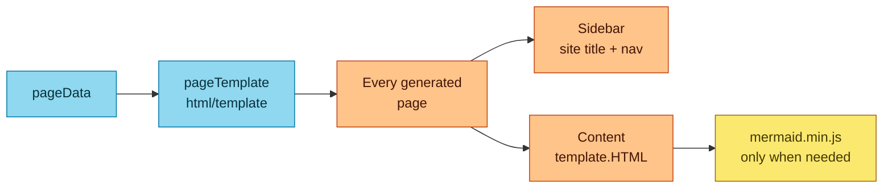

# The page template (`template.go`)

`template.go` holds the single HTML page shell every generated page shares, rendered with `html/template`.

## `pageData`

The template's data:

- `SiteTitle` — from the `.barnacle.json` `title` (see [config.go.md](config.go.md)); shown as the sidebar site title and in `<title>`.
- `PageTitle` — the page's own title (`<title>` and heading content come from the page body itself).
- `Content` — `template.HTML` page body (already-rendered HTML from [render.go.md](render.go.md) or [MermaidPageHTML](render.go.md)), injected verbatim.
- `Nav` — `template.HTML` sidebar navigation from `renderNav` (see [nav.go.md](nav.go.md)).
- `RelPrefix` — `"../"` repeated per level of nesting (`""` for top-level pages, `"../"` for `parser/parser.html`); prefixes the `assets/barnacle.css` and `assets/mermaid.min.js` URLs so relative links work from any depth. Computed by `relPrefix` in [site.go.md](site.go.md).
- `HasMermaid` — when true, the shell adds `<script src="{{.RelPrefix}}assets/mermaid.min.js">` and calls `mermaid.initialize({ startOnLoad: true, securityLevel: 'strict' })`.

## The shell

A fixed `<!DOCTYPE html>` document: `<meta name="generator" content="barnacle">`, a sidebar `<aside>` with the site title linked to `index.html` and the nav, a `<main class="content">`, and a footer linking to the barnacle repository. `<title>` is `PageTitle · SiteTitle`, collapsing to just `PageTitle` when the two are equal (the landing page).

Page content is inserted as `template.HTML` — it is trusted HTML produced by the renderer (goldmark with `WithUnsafe`), not user input from the browser. Everything else (titles, nav) is escaped by `html/template` or `html.EscapeString` upstream.

`securityLevel: 'strict'` is deliberate: `click` links and tooltips still work (relative `href` targets pass Mermaid's URL sanitizer), but JavaScript callbacks in `click` directives are not attached, and all diagram text goes through the sanitizer. Documentation-targets inside diagram labels are rewritten the same way Markdown links are — see [render.go.md](render.go.md).

## Where it is used

`renderPage` in [site.go.md](site.go.md) executes `pageTemplate` once per page, including `index.html`.

## Related pages

- [The site generator](site.go.md) — executes the template via `renderPage`
- [Navigation and landing page](nav.go.md) — produces `Nav` and the index content
- [The renderer](render.go.md) — produces `Content` and reports `HasMermaid`
- [Configuration](config.go.md) — supplies `SiteTitle`
- [README.md](README.md) — package hub
