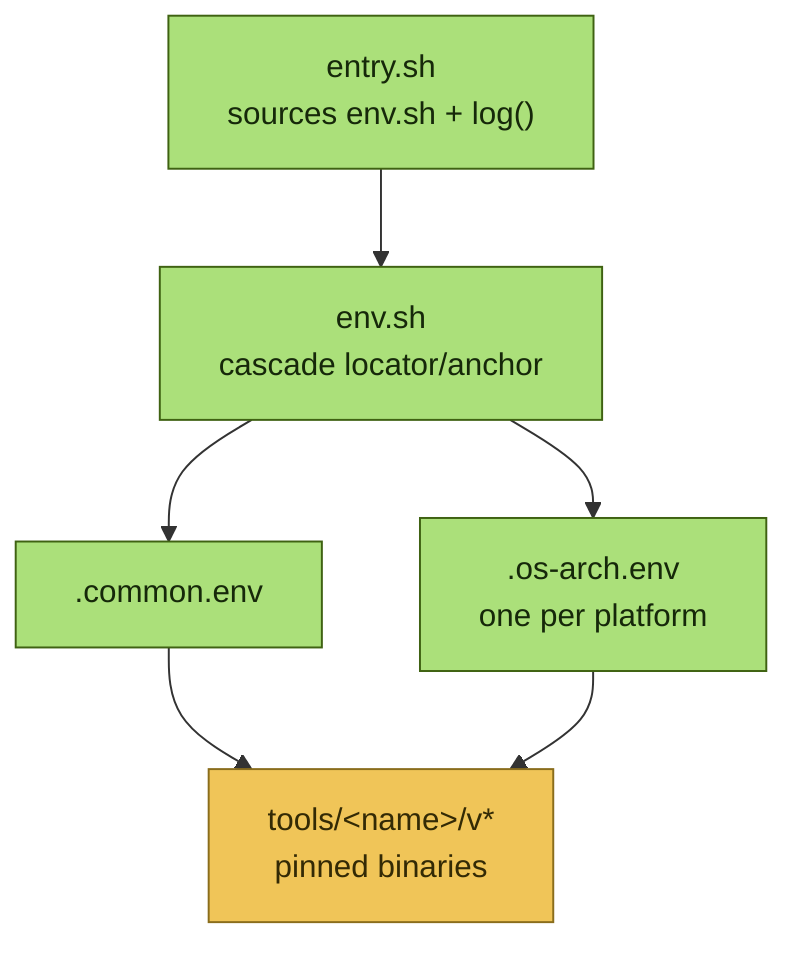

# Repository script tooling (`scripts/`)

The `scripts/` directory carries the repository's build/release/docs tooling: an environment cascade the other scripts source, plus one entry point per task. Everything here is bash; nothing requires a global install beyond what each script documents.

Vernacular used in the headers (`log INFO`, `$REPO_ROOT_DIR`, `VERSIONER_BIN`): read [entry.sh.md](entry.sh.md) first, then [env.sh.md](env.sh.md).

## The cascade (why the dotfiles exist)

- `scripts/entry.sh` — sources `scripts/env.sh` and defines `log()` (logamuffin, with a printf fallback). Sourced by everything else. See [entry.sh.md](entry.sh.md).
- `scripts/env.sh` — locates and sources the cascade below, then anchors the repository-relative `*_BIN` tool paths to absolute paths. See [env.sh.md](env.sh.md).
- `scripts/.common.env`, `scripts/.<os>-<arch>.env` — the cascade proper. Hidden files, so barnacle does not render them as pages; [env.sh.md](env.sh.md) is their documentation. `.common.env` holds the platform-independent settings (`TOOLS_DIR=tools`, the `fordaj/*` upstream repos, and the pinned `*_VERSION_DIR`s: versioner v0.0.3.0.5, logamuffin v0.1.3.0.35, runner-spawner v0.0.1.2.6, barnacle v0.0.1.0.16); each platform file sets `PROJECT_PLATFORM` and the `*_BIN` paths for its `<os>-<arch>`.

## Task scripts

- [build.sh](build.sh.md) — cross-compile barnacle for the six supported platforms into `dist/`, stamping the versioner-computed version into each binary.
- [version.sh](version.sh.md) — print the repository version computed by versioner (`--format text|shell|json`).
- [release.sh](release.sh.md) — version, verify, cross-compile, package, tag, push, and publish the GitHub release.
- [docs.sh](docs.sh.md) — generate the documentation site you are reading, with the pinned barnacle.
- [format.sh](format.sh.md) — format the repository in place with formattington.

## Refreshing the pinned tools

The `tools/<name>/update.sh` scripts refresh the pinned helper bundles (versioner, logamuffin, runner-spawner, formattington-lite, barnacle). They are not rendered as part of this site (`tools/` is excluded in `.barnacle.json`); their pages live under `tools/` and are listed in `tools/README.md`.

## Related pages

- [../README.md](../README.md) — the repository README
- [../AGENTS.md](../AGENTS.md) — the documentation rules these pages follow
