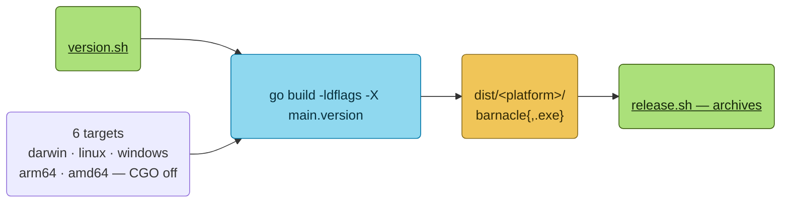

# The build script (`scripts/build.sh`)



Cross-compiles barnacle for every supported platform into `dist/<platform>/barnacle` (`barnacle.exe` on Windows), stamping the version computed by versioner into each binary.

## What it does

1. Sources [entry.sh.md](entry.sh.md) and changes into the repository root (`REPO_ROOT_DIR`).
2. Resolves the version: `$VERSION` if set, otherwise `eval "$(scripts/version.sh --format shell)"`.
3. Fails early if the `go` toolchain is not on `PATH`.
4. Builds six targets with `CGO_ENABLED=0`, `-trimpath`, and `-ldflags "-s -w -X main.version=$VERSION"`: `macos-arm64`, `macos-x86_64`, `linux-arm64`, `linux-x86_64`, `windows-arm64`, `windows-x86_64` (GOOS/GOARCH `darwin`/`linux`/`windows` × `arm64`/`amd64`).
5. Writes each binary to `dist/<platform>/` and logs progress through `log()`.

`dist/` is git-ignored and always excluded from the scan.

## Usage

```bash
scripts/build.sh            # build all six platforms into dist/
VERSION=1.2.3.4 scripts/build.sh   # override the stamped version
```

## Consumers

[release.sh.md](release.sh.md) calls `build.sh` with `VERSION` set, then packages the resulting per-platform directories into the release archives. The README's "Building from source" section documents it for one-off local builds.

## Related pages

- [version.sh.md](version.sh.md) — where the stamped version comes from
- [release.sh.md](release.sh.md) — the release pipeline built on this script
- [entry.sh.md](entry.sh.md) · [env.sh.md](env.sh.md)
- [README.md](README.md) — the scripts hub
