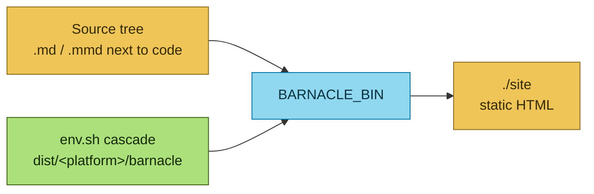

# The docs generator (`scripts/docs.sh`)



Generates the documentation site you are reading: it runs the barnacle binary built from this source tree — `dist/<platform>/barnacle[.exe]`, produced by [`scripts/build.sh`](build.sh.md) — against this repository. This repository is the barnacle project itself, so the site you get always reflects the tree at hand; no release is needed to render your changes. On a fresh clone, run `scripts/build.sh` once before the first `scripts/docs.sh`.

Barnacle scans the working tree for Markdown (`.md`) and Mermaid (`.mmd`) files, renders each as a page, and keeps relative links between them. Generated output is static HTML; it is written to `./site/` by default and is never committed (it is in `.gitignore`; `site/` is always excluded from the scan).

## Usage

```bash
scripts/docs.sh                       # generate into ./site/
scripts/docs.sh --site ./public       # forward --site to barnacle
scripts/docs.sh --config ./docs/barnacle.json
scripts/docs.sh --help                # usage for this script
```

Any arguments other than `--help`/`-h` are forwarded to barnacle verbatim; see `barnacle --help` for `--config`/`--site` semantics. Barnacle's exit code is barnacle's own; a missing or non-executable binary makes this script fail with instructions to run `scripts/build.sh` (or set `BARNACLE_BIN` explicitly).

## How it locates barnacle

Sources [entry.sh.md](entry.sh.md) and resolves `BARNACLE_BIN` through the [cascade](env.sh.md) (`dist/<platform>/barnacle[.exe]` by default). It then runs barnacle with the repository root as the working directory, so barnacle's auto-discovered `./.barnacle.json` and its default `./site/` output land at the repository root no matter where the script is invoked from.

This repository's `.barnacle.json` sets `title` to `barnacle` and excludes `tools` and `dist` (the pinned helper bundles carry their own upstream documentation); the output directory is always excluded, and hidden files and directories (including the cascade's `.common.env` et al.) are skipped unless `.barnacle.json` sets `includeHidden`.

## Staying in sync with source

The binary under `dist/` is a build artifact of this tree, not a downloaded pin — so the site always reflects whatever the tree renders today. To refresh it after changing the renderer or the template, rerun `scripts/build.sh` (incremental; the whole cross-compile takes a few seconds) and then `scripts/docs.sh`.

Setting `BARNACLE_BIN` overrides the binary used, exactly as before:

```bash
BARNACLE_BIN=/path/to/barnacle scripts/docs.sh
```

`BARNACLE_BIN` is honoured verbatim — repository-relative paths are anchored to the repository root by the cascade; absolute paths are left untouched.

## What the site contains

Every `.md`/`.mmd` in the tree — including this one — except the excluded `tools/` and `dist/` trees and hidden files. See the [root README](../README.md) and [AGENTS.md](../AGENTS.md). Because `tools/` is excluded, the pages under `tools/` are not part of the site and are not linked from site pages.

## Related pages

- [entry.sh.md](entry.sh.md) · [env.sh.md](env.sh.md) — how `BARNACLE_BIN` is resolved
- [README.md](README.md) — the scripts hub
- [../AGENTS.md](../AGENTS.md) — the documentation rules this site follows
