# The script entry point (`scripts/entry.sh`)

```mermaid
flowchart LR
    Script["<span style='position:relative;display:inline-block'><svg class='label-icon' viewBox='0 0 24 24' width='15' height='15' style='position:absolute;left:-32px;top:-15px' fill='none' stroke='currentColor' stroke-width='1.9' stroke-linecap='round' stroke-linejoin='round'><path d='M5 8l4.5 4L5 16'/><path d='M12 16.5h7'/></svg>Any scripts/*.sh</span>"] --> Entry["<span style='position:relative;display:inline-block'><svg class='label-icon' viewBox='0 0 24 24' width='15' height='15' style='position:absolute;left:-32px;top:-15px' fill='none' stroke='currentColor' stroke-width='1.9' stroke-linecap='round' stroke-linejoin='round'><path d='M5 8l4.5 4L5 16'/><path d='M12 16.5h7'/></svg>entry.sh</span>"]
    Entry --> Env["<span style='position:relative;display:inline-block'><svg class='label-icon' viewBox='0 0 24 24' width='15' height='15' style='position:absolute;left:-32px;top:-15px' fill='none' stroke='currentColor' stroke-width='1.9' stroke-linecap='round' stroke-linejoin='round'><path d='M5 8l4.5 4L5 16'/><path d='M12 16.5h7'/></svg><svg class='label-icon' viewBox='0 0 24 24' width='12' height='12' style='position:absolute;right:-31px;top:-14px' fill='none' stroke='currentColor' stroke-width='2.4' stroke-linecap='round' stroke-linejoin='round'><path d='M10 14a5 5 0 0 0 7.07 0L20.6 10.4a5 5 0 0 0-7.07-7.07l-2 2'/><path d='M14 10a5 5 0 0 0-7.07 0L3.4 13.6a5 5 0 0 0 7.07 7.07l2-2'/></svg>env.sh — cascade<br/>VERSIONER_BIN · LOGAMUFFIN_BIN · …</span>"]
    Entry --> Log["<span style='position:relative;display:inline-block'><svg class='label-icon' viewBox='0 0 24 24' width='15' height='15' style='position:absolute;left:-32px;top:-15px' fill='none' stroke='currentColor' stroke-width='1.9' stroke-linecap='round' stroke-linejoin='round'><path d='M5 8l4.5 4L5 16'/><path d='M12 16.5h7'/></svg>log LEVEL MESSAGE</span>"]
    Log -->|binary present| Logamuffin["<span style='position:relative;display:inline-block'><svg class='label-icon' viewBox='0 0 24 24' width='15' height='15' style='position:absolute;left:-32px;top:-15px' fill='none' stroke='currentColor' stroke-width='1.9' stroke-linecap='round' stroke-linejoin='round'><path d='M8.5 7 4 12l4.5 5'/><path d='M15.5 7 20 12l-4.5 5'/></svg>logamuffin</span>"]
    Log -->|missing / fresh clone| Fallback["<span style='position:relative;display:inline-block'><svg class='label-icon' viewBox='0 0 24 24' width='15' height='15' style='position:absolute;left:-32px;top:-15px' fill='none' stroke='currentColor' stroke-width='1.9' stroke-linecap='round' stroke-linejoin='round'><path d='M5 8l4.5 4L5 16'/><path d='M12 16.5h7'/></svg>printf fallback</span>"]
    click Env href "env.sh.md"
    class Script,Entry,Env,Log,Fallback shFile
    class Logamuffin goFile
    classDef shFile fill:#abe07a,stroke:#3f6212,color:#16280a
    classDef goFile fill:#8fd8ef,stroke:#0277a8,color:#08303d
```



Every repository script sources `scripts/entry.sh` instead of the individual cascade files, because it does two jobs at once:

1. **It loads the environment** — it sources [env.sh.md](env.sh.md), which sources the hidden cascade (`.common.env` plus the platform file selected from `uname`).
2. **It defines `log()`** — the shared logging function used by the scripts and by the `tools/*/update.sh` refresh scripts.

## `log()` semantics

`log LEVEL MESSAGE...` forwards to the pinned logamuffin binary referenced by `LOGAMUFFIN_BIN`. The caller context is passed through in `LOG_SOURCE` (`file[:function]:line`), and logamuffin's own exit code (`0` for success/filtered, `2` for usage/config errors) is preserved even under `set -e`.

When the binary is missing or not executable (a fresh clone before tools are populated), `log()` falls back to a `printf` implementation with the same call shape: word-to-severity mapping (TRACE…ALWAYS → numeric thresholds), `LOG_LEVEL`/`LOGAMUFFIN_LEVEL` filtering, and stream routing (ERROR and above to stderr, everything else to stdout). The fallback exists so the scripts work on a brand-new checkout without network access. With no arguments, the fallback prints a usage message to stderr and returns `2`.

## Usage

```bash
#!/usr/bin/env bash
set -euo pipefail
SCRIPT_DIR=$(cd -- "$(dirname -- "${BASH_SOURCE[0]}")" && pwd)
. "$SCRIPT_DIR/env.sh"      # or entry.sh when you also need log()
```

## Related pages

- [env.sh.md](env.sh.md) — the cascade `entry.sh` loads
- [version.sh.md](version.sh.md) — the version script that sources `entry.sh`
- [build.sh.md](build.sh.md) · [release.sh.md](release.sh.md) — consumers of `log()` and the cascade
- [README.md](README.md) — the scripts hub
