# The environment cascade (`scripts/env.sh` + the hidden `.*.env` files)

```mermaid
flowchart TD
    Uname["<span style='position:relative;display:inline-block'><svg class='label-icon' viewBox='0 0 24 24' width='15' height='15' style='position:absolute;left:-32px;top:-15px' fill='none' stroke='currentColor' stroke-width='1.9' stroke-linecap='round' stroke-linejoin='round'><path d='M5 8l4.5 4L5 16'/><path d='M12 16.5h7'/></svg>uname -s : -m</span>"] --> Check{{"<span style='position:relative;display:inline-block'><svg class='label-icon' viewBox='0 0 24 24' width='15' height='15' style='position:absolute;left:-32px;top:-15px' fill='none' stroke='currentColor' stroke-width='1.9' stroke-linecap='round' stroke-linejoin='round'><path d='M12 3.2 19.6 7.6v8.8L12 20.8l-7.6-4.4V7.6z'/></svg>platform?</span>"}}
    Check -->|Darwin:arm64| MacArm["<span style='position:relative;display:inline-block'><svg class='label-icon' viewBox='0 0 24 24' width='15' height='15' style='position:absolute;left:-32px;top:-15px' fill='none' stroke='currentColor' stroke-width='1.9' stroke-linecap='round' stroke-linejoin='round'><path d='M5 8l4.5 4L5 16'/><path d='M12 16.5h7'/></svg>.macos-arm64.env</span>"]
    Check -->|Darwin:x86_64| Mac86["<span style='position:relative;display:inline-block'><svg class='label-icon' viewBox='0 0 24 24' width='15' height='15' style='position:absolute;left:-32px;top:-15px' fill='none' stroke='currentColor' stroke-width='1.9' stroke-linecap='round' stroke-linejoin='round'><path d='M5 8l4.5 4L5 16'/><path d='M12 16.5h7'/></svg>.macos-x86_64.env</span>"]
    Check -->|Linux:aarch64| LinArm["<span style='position:relative;display:inline-block'><svg class='label-icon' viewBox='0 0 24 24' width='15' height='15' style='position:absolute;left:-32px;top:-15px' fill='none' stroke='currentColor' stroke-width='1.9' stroke-linecap='round' stroke-linejoin='round'><path d='M5 8l4.5 4L5 16'/><path d='M12 16.5h7'/></svg>.linux-arm64.env</span>"]
    Check -->|Linux:x86_64| Lin86["<span style='position:relative;display:inline-block'><svg class='label-icon' viewBox='0 0 24 24' width='15' height='15' style='position:absolute;left:-32px;top:-15px' fill='none' stroke='currentColor' stroke-width='1.9' stroke-linecap='round' stroke-linejoin='round'><path d='M5 8l4.5 4L5 16'/><path d='M12 16.5h7'/></svg>.linux-x86_64.env</span>"]
    Check -->|Windows:x86_64| Win86["<span style='position:relative;display:inline-block'><svg class='label-icon' viewBox='0 0 24 24' width='15' height='15' style='position:absolute;left:-32px;top:-15px' fill='none' stroke='currentColor' stroke-width='1.9' stroke-linecap='round' stroke-linejoin='round'><path d='M5 8l4.5 4L5 16'/><path d='M12 16.5h7'/></svg>.windows-x86_64.env</span>"]
    Check -->|Windows:arm64| WinArm["<span style='position:relative;display:inline-block'><svg class='label-icon' viewBox='0 0 24 24' width='15' height='15' style='position:absolute;left:-32px;top:-15px' fill='none' stroke='currentColor' stroke-width='1.9' stroke-linecap='round' stroke-linejoin='round'><path d='M5 8l4.5 4L5 16'/><path d='M12 16.5h7'/></svg>.windows-arm64.env</span>"]
    Check -->|other| Error["<span style='position:relative;display:inline-block'><svg class='label-icon' viewBox='0 0 24 24' width='15' height='15' style='position:absolute;left:-32px;top:-15px' fill='none' stroke='currentColor' stroke-width='1.9' stroke-linecap='round' stroke-linejoin='round'><circle cx='12' cy='12' r='8.3'/><path d='M12 8.2v5'/><path d='M12 16.3h.01'/></svg>Error → return 1</span>"]
    MacArm --> Anchor["<span style='position:relative;display:inline-block'><svg class='label-icon' viewBox='0 0 24 24' width='15' height='15' style='position:absolute;left:-32px;top:-15px' fill='none' stroke='currentColor' stroke-width='1.9' stroke-linecap='round' stroke-linejoin='round'><path d='M5 8l4.5 4L5 16'/><path d='M12 16.5h7'/></svg>Anchor *_BIN to repo root</span>"]
    Mac86 --> Anchor
    LinArm --> Anchor
    Lin86 --> Anchor
    Win86 --> Anchor
    WinArm --> Anchor
    Common["<span style='position:relative;display:inline-block'><svg class='label-icon' viewBox='0 0 24 24' width='15' height='15' style='position:absolute;left:-32px;top:-15px' fill='none' stroke='currentColor' stroke-width='1.9' stroke-linecap='round' stroke-linejoin='round'><path d='M5 8l4.5 4L5 16'/><path d='M12 16.5h7'/></svg>.common.env</span>"] -.-> Anchor
    class Uname,Anchor shFile
    class Check hexNode
    class MacArm,Mac86,LinArm,Lin86,Win86,WinArm,Common shFile
    class Error errNode
    classDef shFile fill:#abe07a,stroke:#3f6212,color:#16280a
    classDef hexNode fill:#ffe08a,stroke:#a16207,color:#422006
    classDef errNode fill:#f6b8b8,stroke:#b91c1c,color:#450a0a
```

`scripts/env.sh` is the plumbing that makes the pinned helper tools resolvable from any script, in any working directory, on every supported platform. It is sourced — never executed — and it works from both bash and zsh.

## What it does

1. Locates the cascade files relative to itself (bash via `$BASH_SOURCE`, zsh via `%x`, `eval`-wrapped so bash never parses the zsh-only syntax) so sourcing works from any cwd.
2. Brings in `.common.env`, then the platform file selected by `uname -s`/`uname -m` (`Darwin:arm64` → `.macos-arm64.env`, `Linux:x86_64` → `.linux-x86_64.env`, `Linux:aarch64` → `.linux-arm64.env`, `MINGW*`/`MSYS*`/`CYGWIN*` on x86_64/arm64 → `.windows-x86_64.env` / `.windows-arm64.env`). Unsupported platforms print an error and return `1`.
3. **Anchors** every repository-relative `*_BIN` to the repository root (`REPO_ROOT_DIR`), leaving absolute paths untouched. After sourcing, `$VERSIONER_BIN`, `$LOGAMUFFIN_BIN`, `$RUNNER_SPAWNER_BIN`, and `$BARNACLE_BIN` are absolute.
4. Sets `REPO_ROOT_DIR` for callers that need the repository root (for example [version.sh.md](version.sh.md)).

A `*_BIN` set by the caller always wins over the pinned default: the platform files expand each path as `${NAME:-${VERSION_DIR}/<platform>/<binary>}`, so `BARNACLE_BIN=dist/macos-arm64/barnacle scripts/docs.sh` renders the site with a locally built barnacle instead of the pinned release. (Before this behaviour existed, the cascade silently overwrote a caller-set `BARNACLE_BIN`.)

Everything is exported with `set -a` while sourcing and un-exported at the end, so the cascade does not leak into the caller's environment beyond the intended variables.

## The hidden files

Hidden files are excluded from barnacle's default scan (this repository's `.barnacle.json` excludes `tools` and `dist`, and hidden files are skipped everywhere by default), so their contract is documented here:

- **`.common.env`** — `TOOLS_DIR=tools`; the upstream `fordaj/*` repository slugs (with the versioner's `VERSIONER_TAG_PATTERN` and `VERSIONER_CONFIG_FILE`); the pinned `*_VERSION_DIR`s:
  - `VERSIONER_VERSION_DIR` → `tools/versioner/v0.0.3.0.5`
  - `LOGAMUFFIN_VERSION_DIR` → `tools/logamuffin/v0.1.3.0.35`
  - `RUNNER_SPAWNER_VERSION_DIR` → `tools/runner-spawner/v0.0.1.2.6`
  - `BARNACLE_VERSION_DIR` → `tools/barnacle/v0.0.1.0.16`

  When bumping a pinned tool, this file names the version directory the platform files point into.

- **`.<platform>.env`** — one per supported platform (`linux-arm64`, `linux-x86_64`, `macos-arm64`, `macos-x86_64`, `windows-arm64`, `windows-x86_64`). Each sets `PROJECT_PLATFORM` and the `*_BIN` paths, including `BARNACLE_BIN`. Two platform-file caveats are recorded inline: runner-spawner reports unsupported on Linux (macOS + Windows only; the Linux binaries ship for uniform bundle layout), and there is no windows-arm64 versioner bundle upstream — `.windows-arm64.env` points `VERSIONER_BIN` at the `windows-x86_64` path, which does not exist as a versioner bundle; set `VERSIONER_BIN` explicitly there if needed.

## Related pages

- [entry.sh.md](entry.sh.md) — the entry point most scripts source (it loads this file and defines `log()`)
- [docs.sh.md](docs.sh.md) — the docs generator that resolves `BARNACLE_BIN` through this cascade
- [README.md](README.md) — the scripts hub
