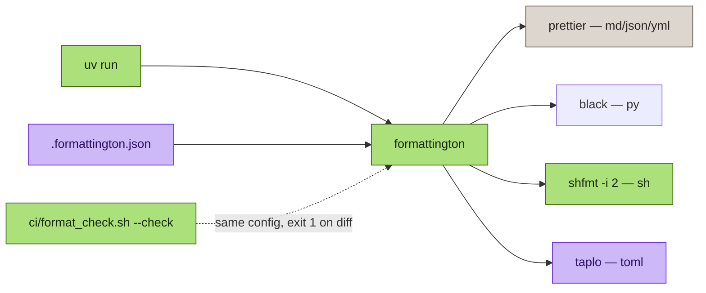

# The formatter (`scripts/format.sh`)



Formats the barnacle repository in place with [formattington](https://github.com/fordaj/formattington). This repository dogfoods it for its own Markdown, Python, shell, and TOML files.

## What it does

- Resolves the repository root (the parent of `scripts/`) and `cd`s there.
- Requires `uv` on `PATH` (https://docs.astral.sh/uv/); fails with a clear error otherwise.
- Runs `uv run formattington --config "$REPO_ROOT/.formattington.json" all` with any extra arguments you pass.

Formattington is pinned in `pyproject.toml` to a git commit (no PyPI release exists yet) and locked in `uv.lock`; `uv run` creates `.venv/` automatically on first use. This project uses Python 3.14 (see `.python-version`), the latest version formattington supports.

## Scope (`.formattington.json`)

| Files                    | Tool         |
| ------------------------ | ------------ |
| Markdown (`*.md`)        | prettier     |
| JSON (`*.json`)          | prettier     |
| YAML (`*.yml`)           | prettier     |
| Python (`*.py`)          | black        |
| Shell (`*.sh`, `*.bash`) | shfmt `-i 2` |
| TOML (`*.toml`)          | taplo        |

Style for the JavaScript/Markdown/YAML/JSON formatter is configured by formattington's own defaults plus any `.prettierrc` present at the repository root (the `scripts/format.sh` header notes this; no `.prettierrc` is currently tracked). The bundled binaries under `tools/` and generated locations such as `dist/` are skipped.

## Prerequisites

Formatter executables must be on `PATH` (formattington exits `127` if one is missing): `shfmt`, `prettier`, `taplo` (e.g. via your OS package manager or npm for prettier); `black` is provided by the uv environment. `uv` is required at run time.

## Usage

```bash
./scripts/format.sh              # format all matching files in place
./scripts/format.sh --series     # format sequentially (ordered output)
./scripts/format.sh --verbose    # show which formatter executables were resolved
```

Extra flags are forwarded to `formattington` before `all` (e.g. `--series`, `--verbose`). `--config` is managed by the script; do not pass it.

To check formatting without modifying files (CI), use `./ci/format_check.sh`, which runs the same configuration with `--check` — see the README's "Formatting and CI" section.

## Related pages

- [README.md](../README.md) — the repository README (formatting and CI are documented there)
- [AGENTS.md](../AGENTS.md) — the same rules restated for contributors and agents
- [README.md](README.md) — the scripts that consume the same cascade
