# The release script (`scripts/release.sh`)

```mermaid
flowchart LR
    Versioner["<span style='position:relative;display:inline-block'><svg class='label-icon' viewBox='0 0 24 24' width='15' height='15' style='position:absolute;left:-32px;top:-15px' fill='none' stroke='currentColor' stroke-width='1.9' stroke-linecap='round' stroke-linejoin='round'><path d='M4.5 4.5h6.4a2 2 0 0 1 1.4.6l7.3 7.3a2 2 0 0 1 0 2.9l-4.3 4.3a2 2 0 0 1-2.9 0l-7.3-7.3a2 2 0 0 1-.6-1.4V4.5z'/><circle cx='8.7' cy='8.7' r='0.9' fill='currentColor' stroke='none'/></svg><svg class='label-icon' viewBox='0 0 24 24' width='12' height='12' style='position:absolute;right:-31px;top:-14px' fill='none' stroke='currentColor' stroke-width='2.4' stroke-linecap='round' stroke-linejoin='round'><path d='M10 14a5 5 0 0 0 7.07 0L20.6 10.4a5 5 0 0 0-7.07-7.07l-2 2'/><path d='M14 10a5 5 0 0 0-7.07 0L3.4 13.6a5 5 0 0 0 7.07 7.07l2-2'/></svg>versioner</span>"] --> Verify["<span style='position:relative;display:inline-block'><svg class='label-icon' viewBox='0 0 24 24' width='15' height='15' style='position:absolute;left:-32px;top:-15px' fill='none' stroke='currentColor' stroke-width='1.9' stroke-linecap='round' stroke-linejoin='round'><path d='M5 12.8 9.7 17.5 19 8'/></svg>build throwaway<br/>--version matches?</span>"]
    Verify --> Build["<span style='position:relative;display:inline-block'><svg class='label-icon' viewBox='0 0 24 24' width='15' height='15' style='position:absolute;left:-32px;top:-15px' fill='none' stroke='currentColor' stroke-width='1.9' stroke-linecap='round' stroke-linejoin='round'><path d='M5 8l4.5 4L5 16'/><path d='M12 16.5h7'/></svg><svg class='label-icon' viewBox='0 0 24 24' width='12' height='12' style='position:absolute;right:-31px;top:-14px' fill='none' stroke='currentColor' stroke-width='2.4' stroke-linecap='round' stroke-linejoin='round'><path d='M10 14a5 5 0 0 0 7.07 0L20.6 10.4a5 5 0 0 0-7.07-7.07l-2 2'/><path d='M14 10a5 5 0 0 0-7.07 0L3.4 13.6a5 5 0 0 0 7.07 7.07l2-2'/></svg>build.sh — 6 platforms</span>"]
    Build --> Package["<span style='position:relative;display:inline-block'><svg class='label-icon' viewBox='0 0 24 24' width='15' height='15' style='position:absolute;left:-32px;top:-15px' fill='none' stroke='currentColor' stroke-width='1.9' stroke-linecap='round' stroke-linejoin='round'><path d='M4 8.2 12 4l8 4.2v7.6L12 20l-8-4.2z'/><path d='M4.3 8.5 12 12.4l7.7-3.9'/><path d='M12 12.4V19.5'/></svg>archives<br/>+ checksums.txt</span>"]
    Package --> Tag["<span style='position:relative;display:inline-block'><svg class='label-icon' viewBox='0 0 24 24' width='15' height='15' style='position:absolute;left:-32px;top:-15px' fill='none' stroke='currentColor' stroke-width='1.9' stroke-linecap='round' stroke-linejoin='round'><path d='M4.5 4.5h6.4a2 2 0 0 1 1.4.6l7.3 7.3a2 2 0 0 1 0 2.9l-4.3 4.3a2 2 0 0 1-2.9 0l-7.3-7.3a2 2 0 0 1-.6-1.4V4.5z'/><circle cx='8.7' cy='8.7' r='0.9' fill='currentColor' stroke='none'/></svg>tag HEAD + push</span>"]
    Tag --> GH["<span style='position:relative;display:inline-block'><svg class='label-icon' viewBox='0 0 24 24' width='15' height='15' style='position:absolute;left:-32px;top:-15px' fill='none' stroke='currentColor' stroke-width='1.9' stroke-linecap='round' stroke-linejoin='round'><path d='M4.5 4.5h6.4a2 2 0 0 1 1.4.6l7.3 7.3a2 2 0 0 1 0 2.9l-4.3 4.3a2 2 0 0 1-2.9 0l-7.3-7.3a2 2 0 0 1-.6-1.4V4.5z'/><circle cx='8.7' cy='8.7' r='0.9' fill='currentColor' stroke='none'/></svg>gh release create<br/>or refresh assets</span>"]
    click Build href "build.sh.md"
    click Versioner href "version.sh.md"
    class Versioner,Tag,GH tagNode
    class Verify checkNode
    class Build shFile
    class Package boxNode
    classDef tagNode fill:#f6b8d4,stroke:#be185d,color:#500724
    classDef checkNode fill:#9fe8c9,stroke:#0f766e,color:#052e22
    classDef shFile fill:#abe07a,stroke:#3f6212,color:#16280a
    classDef boxNode fill:#e8cf9d,stroke:#a16207,color:#33240a
```



Computes the next version with versioner (dogfooding), cross-compiles the binaries, packages the release archives, tags HEAD, and creates the GitHub release with the archives attached.

One archive is produced per platform:

```text
barnacle-<platform>.tar.gz    (.zip on Windows)
barnacle-<platform>/          (top-level directory in the archive)
  barnacle{,.exe}  LICENSE  README.md
```

The binaries are built with CGO disabled and are statically linked and portable. The program version is dynamic via versioner (`.versioner.json`); it is stamped into every cross-compiled binary with `-ldflags -X`, so the tag and `barnacle --version` agree by construction.

## Usage

```bash
scripts/release.sh                # version, build, tag, push, release + upload
scripts/release.sh --build-only   # cross-compile into dist/ only (stops before tag/push/release)
scripts/release.sh --dry-run      # compute + verify + build, touch nothing remote
```

`--build-only` tolerates a dirty working tree; a real release refuses one (commit or stash first). `--dry-run` logs the exact tag/push/release commands it would run.

## Prerequisites

`git`, a Go toolchain, `tar`, and `zip`; a real release additionally needs `gh` authenticated for the target repository. Bundled versioner/logamuffin binaries are selected via [entry.sh.md](entry.sh.md) (refresh with `tools/versioner/update.sh` and `tools/logamuffin/update.sh`). Logging uses `log <level> <message>` from `entry.sh` (logamuffin, with printf fallback). The working tree must be clean and `HEAD` should be pushed for a real release.

## What it does

1. Sources [entry.sh.md](entry.sh.md); checks required commands (`gh` only for a real release; `gh auth status` must pass).
2. Refuses to continue on a dirty tree (except `--build-only`/`--dry-run`, which warn); best-effort `git fetch origin --tags`.
3. Computes `VERSION`/`TAG` with `versioner --repo-dir "$REPO_ROOT" --quiet`; the tag must match `vX.Y.Z...`.
4. **Verifies**: builds a throwaway binary stamped with `$VERSION` and requires `barnacle --version` to report it.
5. Cross-compiles into `dist/` via [build.sh.md](build.sh.md) (`VERSION="$VERSION"`), then packages each `dist/<platform>/` into `dist/barnacle-<platform>.tar.gz`/`.zip` staging in a temp directory (binary + `LICENSE` + `README.md`), and writes `dist/checksums.txt` (`shasum -a 256` or `sha256sum`).
6. `--build-only`: stops here. Otherwise tags HEAD (an existing tag is reused), pushes it, and either creates the GitHub release (`gh release create --generate-notes`) or, if it already exists, re-uploads the assets with `--clobber` — the script is idempotent and safe to re-run to (re)attach binaries.

## Related pages

- [build.sh.md](build.sh.md) — the cross-compile step this script wraps
- [version.sh.md](version.sh.md) — how the version is computed
- [entry.sh.md](entry.sh.md) · [env.sh.md](env.sh.md) — the cascade that provides `VERSIONER_BIN`/`LOGAMUFFIN_BIN`
- [README.md](README.md) — the scripts hub
