# The version script (`scripts/version.sh`)

```mermaid
flowchart LR
    Git[Git history] --> Versioner["<span style='position:relative;display:inline-block'><svg class='label-icon' viewBox='0 0 24 24' width='15' height='15' style='position:absolute;left:-32px;top:-15px' fill='none' stroke='currentColor' stroke-width='1.9' stroke-linecap='round' stroke-linejoin='round'><path d='M4.5 4.5h6.4a2 2 0 0 1 1.4.6l7.3 7.3a2 2 0 0 1 0 2.9l-4.3 4.3a2 2 0 0 1-2.9 0l-7.3-7.3a2 2 0 0 1-.6-1.4V4.5z'/><circle cx='8.7' cy='8.7' r='0.9' fill='currentColor' stroke='none'/></svg>versioner --quiet</span>"]
    Rules["<span style='position:relative;display:inline-block'><svg class='label-icon' viewBox='0 0 24 24' width='15' height='15' style='position:absolute;left:-32px;top:-15px' fill='none' stroke='currentColor' stroke-width='1.9' stroke-linecap='round' stroke-linejoin='round'><path d='M9.5 4.5c-2.4 0-3.4 1-3.4 3.5 0 1.8-1 2.8-2 3.5 1 .7 2 1.7 2 3.5 0 2.5 1 3.5 3.4 3.5'/><path d='M14.5 4.5c2.4 0 3.4 1 3.4 3.5 0 1.8 1 2.8 2 3.5-1 .7-2 1.7-2 3.5 0 2.5-1 3.5-3.4 3.5'/></svg>.versioner.json</span>"] --> Versioner
    Versioner --> Out["<span style='position:relative;display:inline-block'><svg class='label-icon' viewBox='0 0 24 24' width='15' height='15' style='position:absolute;left:-32px;top:-15px' fill='none' stroke='currentColor' stroke-width='1.9' stroke-linecap='round' stroke-linejoin='round'><path d='M4.5 5h15v14h-15z'/><path d='M8 14.5v-4l2.2 2.8 2.2-2.8v4'/></svg>VERSION / TAG<br/>text · shell · json</span>"]
    Out --> Build["<span style='position:relative;display:inline-block'><svg class='label-icon' viewBox='0 0 24 24' width='15' height='15' style='position:absolute;left:-32px;top:-15px' fill='none' stroke='currentColor' stroke-width='1.9' stroke-linecap='round' stroke-linejoin='round'><path d='M5 8l4.5 4L5 16'/><path d='M12 16.5h7'/></svg><svg class='label-icon' viewBox='0 0 24 24' width='12' height='12' style='position:absolute;right:-31px;top:-14px' fill='none' stroke='currentColor' stroke-width='2.4' stroke-linecap='round' stroke-linejoin='round'><path d='M10 14a5 5 0 0 0 7.07 0L20.6 10.4a5 5 0 0 0-7.07-7.07l-2 2'/><path d='M14 10a5 5 0 0 0-7.07 0L3.4 13.6a5 5 0 0 0 7.07 7.07l2-2'/></svg>build.sh — stamp binary</span>"]
    Out --> Release["<span style='position:relative;display:inline-block'><svg class='label-icon' viewBox='0 0 24 24' width='15' height='15' style='position:absolute;left:-32px;top:-15px' fill='none' stroke='currentColor' stroke-width='1.9' stroke-linecap='round' stroke-linejoin='round'><path d='M5 8l4.5 4L5 16'/><path d='M12 16.5h7'/></svg><svg class='label-icon' viewBox='0 0 24 24' width='12' height='12' style='position:absolute;right:-31px;top:-14px' fill='none' stroke='currentColor' stroke-width='2.4' stroke-linecap='round' stroke-linejoin='round'><path d='M10 14a5 5 0 0 0 7.07 0L20.6 10.4a5 5 0 0 0-7.07-7.07l-2 2'/><path d='M14 10a5 5 0 0 0-7.07 0L3.4 13.6a5 5 0 0 0 7.07 7.07l2-2'/></svg>release.sh — next tag</span>"]
    click Build href "build.sh.md"
    click Release href "release.sh.md"
    class Versioner tagNode
    class Rules jsonFile
    class Out mdFile
    class Build,Release shFile
    classDef tagNode fill:#f6b8d4,stroke:#be185d,color:#500724
    classDef jsonFile fill:#cdb9f7,stroke:#6d28d9,color:#2e1065
    classDef mdFile fill:#dcd6ce,stroke:#6b6255,color:#292524
    classDef shFile fill:#abe07a,stroke:#3f6212,color:#16280a
```



Prints the version of this repository as computed by the pinned versioner — the same computation the release pipeline uses, so a local build and the published tag can never drift apart.

## Usage

```bash
scripts/version.sh                 # VERSION=<v> and TAG=<t> lines (default)
scripts/version.sh --format text   # same
scripts/version.sh --format shell  # export VERSION=... and export TAG=...
scripts/version.sh --format json   # the raw versioner JSON document
```

`--format` requires a value; `--help`/`-h` prints usage. Unknown arguments and an unknown format are usage errors (exit `2`).

## How it works

Sources [entry.sh.md](entry.sh.md) for the cascade and `log()`. If `VERSIONER_BIN` is unset or not executable, it fails with `no versioner binary found` and exits `1`. Otherwise it runs `versioner --repo-dir <root> --quiet` (plus `--format json` for the `json` format); the repo directory defaults to `VERSIONER_REPO_DIR` or the repository root implied by `REPO_ROOT_DIR` (the parent of `scripts/`).

The computation itself follows `.versioner.json` at the repository root: `defaultBranchVersion: 254`, `exemptBranches: { main: 0 }`, `tagPattern: v[0-9]*`.

## Consumers

- [build.sh.md](build.sh.md) — stamps the version into the cross-compiled binaries (`--format shell`).
- [release.sh.md](release.sh.md) — computes the next tag, verifies the binary reports it, tags and publishes.

## Related pages

- [entry.sh.md](entry.sh.md) · [env.sh.md](env.sh.md)
- [build.sh.md](build.sh.md) · [release.sh.md](release.sh.md)
- [README.md](README.md) — the scripts hub
