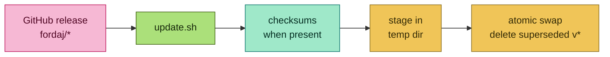

# Pinned helper tools (`tools/`)



`tools/` carries the repository's pinned helper binaries — formatting, logging, CI-runner and docs tooling — plus one `update.sh` per tool that refreshes them. These are the tools used to build, release, log, format, and document this repository itself; they are not Go dependencies.

These pages are **not part of the generated site** (`.barnacle.json` excludes `tools`); they are maintained as ordinary Markdown for people reading the repository.

## Bundling convention

Every bundle follows the same layout:

```text
tools/<name>/
  update.sh           # refresh from the upstream GitHub release
  v<version>/<platform>/<binary>[.exe]
```

- Binaries are pinned by version directory; the pinned version is named by `*_VERSION_DIR` in `scripts/.common.env`.
- `<platform>` is the hyphenated `<os>-<arch>` name (`linux-x86_64`, `macos-arm64`, `windows-x86_64`, …), matching Go and this repository's build layout.
- `update.sh` downloads the latest (or `--tag`ged) upstream release via `gh`, verifies checksums (mandatory for runner-spawner; warn-and-continue for the others when the release ships none), stages into a temporary directory, swaps in atomically, and deletes superseded version folders only after the new one is staged — a failed refresh leaves the previous bundle intact. Each script has `--dry-run`, `--tag`, `--repo`, and `--help`, and resolves its own directory, so it can run from anywhere.
- Archives are platform-native (`.tar.gz` on macOS/Linux, `.zip` on Windows); legacy `.7z` assets are still accepted as a fallback.

## The bundles

| Tool | Used for | Page |
| --- | --- | --- |
| [formattington-lite](formattington-lite/update.sh.md) | Pinned `formattington-lite` formatter binaries (not wired into `./scripts/format.sh` or CI — those run formattington via `uv`) | [update.sh](formattington-lite/update.sh.md) |
| [logamuffin](logamuffin/update.sh.md) | Structured logging backend for `log()` in the scripts | [update.sh](logamuffin/update.sh.md) |
| [runner-spawner](runner-spawner/update.sh.md) | Manages the self-hosted CI runners (see `.runner-spawner.json` and `.github/workflows/ci.yml`) | [update.sh](runner-spawner/update.sh.md) |
| [versioner](versioner/update.sh.md) | Computes the repository version for builds and releases | [update.sh](versioner/update.sh.md) |
| [barnacle](barnacle/update.sh.md) | The pinned barnacle release that renders this documentation site | [update.sh](barnacle/update.sh.md) |

`scripts/.common.env` and `scripts/.<platform>.env` select these via `*_VERSION_DIR`/`*_BIN`; see [scripts/env.sh.md](../scripts/env.sh.md). (Those env files are barnacle-hidden; `scripts/env.sh.md` documents them.)

## Refreshing a pinned tool

```bash
tools/barnacle/update.sh            # download the latest release, verify, swap
tools/barnacle/update.sh --dry-run  # show what would change
```

(Same flags for `versioner`, `logamuffin`, `runner-spawner`, `formattington-lite`.)

## Related pages

- [../scripts/README.md](../scripts/README.md) — the scripts that source the cascade
- [../AGENTS.md](../AGENTS.md) — the documentation rules these pages follow
- [../README.md](../README.md) — the repository README
