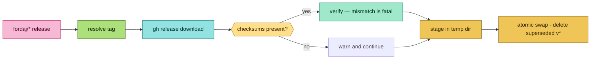

# The barnacle bundle (`tools/barnacle/`)



[Barnacle](https://github.com/fordaj/barnacle) is the documentation-site generator this repository produces and also — by pinning its own latest release — the tool that renders *this* documentation. `scripts/docs.sh` runs this bundled binary against the repository to generate `./site/`; the site you may be reading was built by it, not by a binary built from this source tree.

## Layout

```text
tools/barnacle/
  update.sh                     # refresh from fordaj/barnacle releases
  v0.0.1.0.16/
    macos-arm64/barnacle
    macos-arm64/LICENSE           # upstream MIT text, copied per platform
    macos-x86_64/barnacle
    macos-x86_64/LICENSE
    linux-arm64/barnacle
    linux-arm64/LICENSE
    linux-x86_64/barnacle
    linux-x86_64/LICENSE
    windows-arm64/barnacle.exe
    windows-arm64/LICENSE
    windows-x86_64/barnacle.exe
    windows-x86_64/LICENSE
```

## `update.sh` in detail

Refreshes the pinned binaries from [fordaj/barnacle](https://github.com/fordaj/barnacle) releases. The archives this repository's own `scripts/release.sh` produces — and therefore those `update.sh` consumes — are `barnacle-<platform>.tar.gz` (`.zip` on Windows), each carrying a top-level `barnacle-<platform>/` directory with the binary, `LICENSE`, and `README.md`.

The script:

1. Resolves the tag (latest release, or `--tag vX.Y.Z...` / `BARNACLE_TAG`), validating the tag shape.
2. Downloads via `gh` (`gh release download --pattern '*.tar.gz' --pattern '*.zip' --pattern '*.7z' --pattern 'checksums.txt' --pattern 'SHA256SUMS.txt'`).
3. If the release ships `checksums.txt` or `SHA256SUMS.txt`, verifies exactly the archives downloaded for this run (the file may be cumulative); a mismatch is fatal. If no checksums are present, it logs a warning and installs anyway (unlike runner-spawner, which refuses).
4. Extracts each archive (`tar` for `.tar.gz`; `unzip` for `.zip`, with `7z`/`7zz` only for legacy `.7z` assets), maps the platform (`darwin-amd64` → `macos-x86_64`, `darwin-arm64` → `macos-arm64`, `windows-*`/`linux-*` accordingly, normalizing `amd64`/`x64` → `x86_64`), and finds `barnacle{,.exe}` at the archive root or one level deep (the `barnacle-<platform>/` layout produced by `scripts/release.sh`). Copies the binary into `v<tag>/<platform>/`, makes it executable, and refuses empty ones.
5. If a `LICENSE` is found — at the archive root or one level deep, mirroring the binary search — it is copied into each platform directory alongside the binary (the release archives nest everything one level deep as `barnacle-<platform>/`).
6. Stages everything in a temporary directory, swaps the version directory in atomically, and only then deletes superseded `v*/` directories — a failed refresh leaves the previous bundle intact.
7. Smoke-tests the host binary (`barnacle --version`) and warns if its output does not contain the tag.

`--dry-run` resolves the tag and lists the assets that would be installed without touching anything. `--repo` / `BARNACLE_REPO` and `--tag` / `BARNACLE_TAG` override the defaults. Logging goes through `scripts/entry.sh` (`log()`, with the printf fallback).

## How the repository uses it

[`scripts/docs.sh`](../../scripts/docs.sh.md) resolves `BARNACLE_BIN` through the env cascade (`tools/barnacle/v<version>/<platform>/barnacle[.exe]`, pinned as `BARNACLE_VERSION_DIR` = `v0.0.1.0.16` in `scripts/.common.env`) and runs barnacle with the repository root as cwd, so `./.barnacle.json` (which excludes `tools/` and `dist/`) and the default `./site/` output land at the root. The output is git-ignored and barnacle's `.barnacle-site` marker lets a regeneration wipe stale pages.

Licenses: MIT — see the `LICENSE` in each platform directory, and the repository root of this repository (`LICENSE`).

## Related pages

- [../README.md](../README.md) — the bundle index
- [../../scripts/README.md](../../scripts/README.md) — the scripts that consume the bundle
- [../../scripts/env.sh.md](../../scripts/env.sh.md) — the cascade selecting `BARNACLE_BIN`
- [../../scripts/docs.sh.md](../../scripts/docs.sh.md) — the site generator that uses this bundle
