# The formattington-lite bundle (`tools/formattington-lite/`)

```mermaid
flowchart LR
    Gh["<span style='position:relative;display:inline-block'><svg class='label-icon' viewBox='0 0 24 24' width='15' height='15' style='position:absolute;left:-32px;top:-15px' fill='none' stroke='currentColor' stroke-width='1.9' stroke-linecap='round' stroke-linejoin='round'><path d='M4.5 4.5h6.4a2 2 0 0 1 1.4.6l7.3 7.3a2 2 0 0 1 0 2.9l-4.3 4.3a2 2 0 0 1-2.9 0l-7.3-7.3a2 2 0 0 1-.6-1.4V4.5z'/><circle cx='8.7' cy='8.7' r='0.9' fill='currentColor' stroke='none'/></svg>fordaj/* release</span>"] --> Resolve["<span style='position:relative;display:inline-block'><svg class='label-icon' viewBox='0 0 24 24' width='15' height='15' style='position:absolute;left:-32px;top:-15px' fill='none' stroke='currentColor' stroke-width='1.9' stroke-linecap='round' stroke-linejoin='round'><path d='M5 8l4.5 4L5 16'/><path d='M12 16.5h7'/></svg>resolve tag</span>"]
    Resolve --> Download["<span style='position:relative;display:inline-block'><svg class='label-icon' viewBox='0 0 24 24' width='15' height='15' style='position:absolute;left:-32px;top:-15px' fill='none' stroke='currentColor' stroke-width='1.9' stroke-linecap='round' stroke-linejoin='round'><path d='M12 4.5v10'/><path d='m8 10.5 4 4 4-4'/><path d='M5.5 19h13'/></svg>gh release download</span>"]
    Download --> Check{{"<span style='position:relative;display:inline-block'><svg class='label-icon' viewBox='0 0 24 24' width='15' height='15' style='position:absolute;left:-32px;top:-15px' fill='none' stroke='currentColor' stroke-width='1.9' stroke-linecap='round' stroke-linejoin='round'><path d='M12 3.2 19.6 7.6v8.8L12 20.8l-7.6-4.4V7.6z'/></svg>checksums present?</span>"}}
    Check -->|yes| Verify["<span style='position:relative;display:inline-block'><svg class='label-icon' viewBox='0 0 24 24' width='15' height='15' style='position:absolute;left:-32px;top:-15px' fill='none' stroke='currentColor' stroke-width='1.9' stroke-linecap='round' stroke-linejoin='round'><path d='M5 12.8 9.7 17.5 19 8'/></svg>verify — mismatch is fatal</span>"]
    Check -->|no| Warn[warn and continue]
    Verify --> Stage["<span style='position:relative;display:inline-block'><svg class='label-icon' viewBox='0 0 24 24' width='15' height='15' style='position:absolute;left:-32px;top:-15px' fill='none' stroke='currentColor' stroke-width='1.9' stroke-linecap='round' stroke-linejoin='round'><path d='M3.5 5.7A2.2 2.2 0 0 1 5.7 3.5h4L12 6h5.3a2.2 2.2 0 0 1 2.2 2.2v8.6a2.2 2.2 0 0 1-2.2 2.2H5.7a2.2 2.2 0 0 1-2.2-2.2z'/></svg>stage in temp dir</span>"]
    Warn --> Stage
    Stage --> Swap["<span style='position:relative;display:inline-block'><svg class='label-icon' viewBox='0 0 24 24' width='15' height='15' style='position:absolute;left:-32px;top:-15px' fill='none' stroke='currentColor' stroke-width='1.9' stroke-linecap='round' stroke-linejoin='round'><path d='M3.5 5.7A2.2 2.2 0 0 1 5.7 3.5h4L12 6h5.3a2.2 2.2 0 0 1 2.2 2.2v8.6a2.2 2.2 0 0 1-2.2 2.2H5.7a2.2 2.2 0 0 1-2.2-2.2z'/></svg>atomic swap · delete superseded v*</span>"]
    class Gh tagNode
    class Resolve shFile
    class Download dlNode
    class Check hexNode
    class Verify checkNode
    class Stage,Swap folder
    classDef tagNode fill:#f6b8d4,stroke:#be185d,color:#500724
    classDef shFile fill:#abe07a,stroke:#3f6212,color:#16280a
    classDef dlNode fill:#93e2e2,stroke:#0f766e,color:#042f2e
    classDef hexNode fill:#ffe08a,stroke:#a16207,color:#422006
    classDef checkNode fill:#9fe8c9,stroke:#0f766e,color:#052e22
    classDef folder fill:#f0c558,stroke:#8a6d1c,color:#332a05
```



Pinned [formattington](https://github.com/fordaj/formattington) `formattington-lite` binaries, refreshed from `fordaj/formattington` releases. Note that nothing in this repository's scripts consumes this bundle — `./scripts/format.sh` and CI (`./ci/format_check.sh`) run formattington through `uv` (pinned commit in `pyproject.toml`/`uv.lock`), not through this directory. The bundle is kept ready for direct use.

## Layout

```text
tools/formattington-lite/
  update.sh                     # refresh from fordaj/formattington releases
  v0.0.2.0.53/
    <platform>/formattington{,.exe}
    <platform>/NOTICE.md
    <platform>/LICENSES/*.txt
```

`<platform>` is one of `macos-arm64`, `macos-x86_64`, `linux-arm64`, `linux-x86_64`, `windows-arm64`, `windows-x86_64`. Unlike the other bundles, this one keeps `NOTICE.md` and the `LICENSES/` directory alongside the binary (attribution for the bundled formatters).

## `update.sh`

Refreshes from `fordaj/formattington`: consumes only assets whose stem ends in `-lite` (e.g. `formattington-<platform>-lite.tar.gz`/`.zip`; the `-full` variant is rejected), mapped onto the bundle layout (`darwin-amd64` → `macos-x86_64`, etc., normalizing `amd64`/`x64` → `x86_64`). Verified against the release's `checksums.txt`/`SHA256SUMS.txt` when present (mismatch is fatal; missing checksums warn and install anyway). Legacy `.7z` assets are accepted with `7z`/`7zz`. Only the binary, `NOTICE.md`, and `LICENSES/` are kept; the swap is staged atomically and superseded `v*/` directories are deleted only afterwards. `--dry-run`, `--tag`, `--repo`; env `FORMATTINGTON_REPO`, `FORMATTINGTON_TAG`. Logging via `scripts/entry.sh`.

## Related pages

- [../README.md](../README.md) — the bundle index
- [../../scripts/format.sh.md](../../scripts/format.sh.md) — how formattington is actually run in this repository
- [../../scripts/env.sh.md](../../scripts/env.sh.md) — the cascade (which does not select this bundle)
