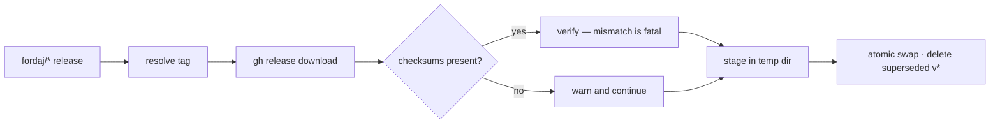

# The logamuffin bundle (`tools/logamuffin/`)

[Logamuffin](https://github.com/fordaj/logamuffin) is the structured logger used by this repository's scripts: timestamped, leveled `log <level> <message>` records. The scripts' `log()` wrapper ([scripts/entry.sh.md](../../scripts/entry.sh.md)) forwards to the pinned binary when it is present and falls back to an equivalent `printf` implementation when it is not, so a fresh clone works without it.

The scripts themselves document the contract (`log INFO "..."`), the `LOG_LEVEL`/`LOGAMUFFIN_LEVEL` filter, and the `LOG_SOURCE` caller-context field that `entry.sh` injects.

## Bundled platforms

`v0.1.3.0.35/` — `macos-arm64`, `macos-x86_64`, `linux-arm64`, `linux-x86_64`, `windows-arm64`, `windows-x86_64` (selected via `LOGAMUFFIN_BIN` from the cascade).

## `update.sh`

Refreshes from `fordaj/logamuffin` releases: archives whose stems carry the `<os>-<arch>` suffix (any single separator; `darwin-*`/`amd64`/`x64` are normalized onto the bundle layout), verified against the release's `checksums.txt`/`SHA256SUMS.txt` when present (mismatch is fatal; missing checksums warn and install anyway). Only the binary is kept; the swap is staged atomically and superseded `v*/` directories are deleted afterwards. `--dry-run`, `--tag`, `--repo`; env `LOGAMUFFIN_REPO`, `LOGAMUFFIN_TAG`. Logging via `scripts/entry.sh`. See [../README.md](../README.md) for the shared bundle contract.

## Related pages

- [../README.md](../README.md) — the bundle index
- [../../scripts/entry.sh.md](../../scripts/entry.sh.md) — the `log()` wrapper that calls it
- [../../scripts/env.sh.md](../../scripts/env.sh.md) — the cascade selecting `LOGAMUFFIN_BIN`
