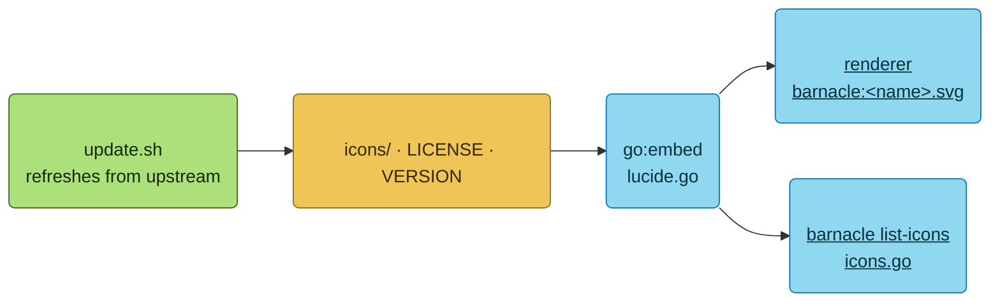

# The embedded Lucide bundle (`tools/lucide/lucide.go`)

`lucide.go` is the reason this bundle is a Go package and not just a content directory: it embeds `icons/*.svg`, `LICENSE` and `VERSION` into **every barnacle binary** with `go:embed` (`var FS embed.FS`), so the binaries are self-contained — no icon is read from disk at runtime, and the license travels inside the executable.

It is refreshed indirectly, never edited by hand: [update.sh](update.sh.md) swaps `icons/`, `LICENSE` and `VERSION` in place, and the next `go build` embeds the new set. The vendored files remain the single source of truth; this file only re-exports them.

## What it exports

| Export | Purpose |
| --- | --- |
| `FS` | The embedded tree (`icons/…`, `LICENSE`, `VERSION`) for callers that want raw access. |
| `Version()` | The vendored release tag (for example `1.73.0`), trimmed. |
| `License()` | The upstream LICENSE text (ISC + the Feather-derived MIT section), byte for byte. |
| `IconNames()` | The sorted names of every embedded icon, without the `.svg` suffix; never empty for a healthy bundle. |
| `Icon(name)` | The bytes of one icon. `name` must be the hyphenated lowercase set name — anything else is an error naming `barnacle list-icons`. |
| `Attribution()` | The credit block `barnacle list-icons` prints: project, link, license. |
| `Name` / `Homepage` / `Source` / `LicenseName` | The attribution constants (`Lucide`, `https://lucide.dev`, the repository, `ISC`). |

Name validation (`^[a-z0-9]+(-[a-z0-9]+)*$`) matches the vendored set exactly — 2055 icons as of 1.73.0 — and rejects path separators, so an embedded lookup can never escape `icons/`.

## Attribution and licensing

The icons are [Lucide](https://lucide.dev), © Lucide Icons and contributors — **ISC-licensed**, with the Feather-derived icons retaining their MIT License. Both texts are embedded in every binary (this package) **and** copied next to every release binary as `LUCIDE-LICENSE` ([scripts/build.sh.md](../../scripts/build.sh.md)) **and** shipped inside every release archive ([scripts/release.sh.md](../../scripts/release.sh.md)). `barnacle list-icons` prints the attribution with its link (see [`internal/barnacle/icons.go.md`](../../internal/barnacle/icons.go.md)).

The bundle remains out of the generated site (`.barnacle.json` excludes `tools`); the embedded copy is what users reference through the `barnacle:<name>.svg` shorthand documented in the [renderer](../../internal/barnacle/render.go.md).

## Related pages

- [update.sh.md](update.sh.md) — how the vendored files get refreshed
- [internal/barnacle/README.md](../../internal/barnacle/README.md) — the package whose binaries embed this set
- [internal/barnacle/render.go.md](../../internal/barnacle/render.go.md) — the `barnacle:<name>.svg` shorthand
- [internal/barnacle/icons.go.md](../../internal/barnacle/icons.go.md) — the `list-icons` implementation and its output
- [tools/README.md](../README.md) — the bundle index
