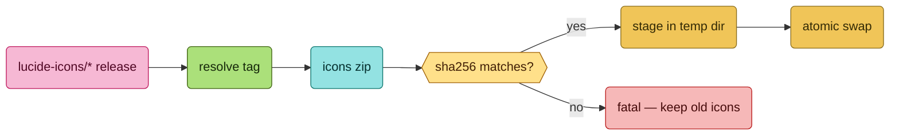

# The lucide bundle (`tools/lucide/`)



The [Lucide](https://lucide.dev) icon set, vendored at a pinned version so this repository's documentation (and anything else that reads these files) can use real, recognizable SVG icons instead of hand-drawn placeholders. Every icon is a 24×24 viewBox stroke-`currentColor` glyph; the same ones are used in the diagram glyphs throughout this documentation.

The "icons json" twins for JS consumers are deliberately not vendored — this bundle is content only, and icons are inlined straight into diagram labels instead of being loaded at runtime (see [`scripts/docs.sh.md`](../../scripts/docs.sh.md) for how barnacle inlines local SVG `` tags into the generated site, so nothing but the diagram source reaches the browser).

**Credit applies to the vendored set**: Lucide is ISC-licensed and a Feather-derivative section of the license retains Nodebird's MIT text — both are in `LICENSE` in this directory, kept verbatim by `update.sh`. Attribution lives here and in the README's diagram conventions; the rendered site itself carries no per-icon credit line.

## `update.sh`

Refreshes from [`lucide-icons/lucide`](https://github.com/lucide-icons/lucide) releases: resolves the newest release tag matching `^[0-9]+(\.[0-9]+)+$` (release candidates and `@lucide/lab` releases share the repo and are skipped automatically; `--tag` bypasses that filter with an explicit tag), downloads `lucide-icons-<tag>.zip` (icons only, ~1.5 MB), verifies its SHA256 against the asset digest GitHub reports (`gh api` releases query), extracts only `icons/*.svg`, and stages them into a temporary directory together with the refreshed `VERSION` (bare tag) and `LICENSE` (fetched from the same tag) before swapping atomically — a failure anywhere before the swap leaves the previous bundle intact.

Only the SVG icons are vendored; the `.json` twins are dropped. Layout after a successful run:

```text
tools/lucide/
  update.sh
  VERSION           # e.g. 1.73.0
  LICENSE           # ISC + the Feather-derived MIT section
  icons/<name>.svg  # 2055 files as of 1.73.0
```

`--dry-run`, `--tag`, `--repo`; env `LUCIDE_REPO`, `LUCIDE_TAG`. Logging via `scripts/entry.sh`. The icons are committed to the repository deliberately — they are content this tree depends on, not derived build output.

## Related pages

- [../README.md](../README.md) — the bundle index
- [../../scripts/docs.sh.md](../../scripts/docs.sh.md) — the docs generator that consumes these icons
- [../../README.md](../../README.md) — diagram conventions showing the glyphs in use
