# The runner-spawner bundle (`tools/runner-spawner/`)

```mermaid
flowchart LR
    Gh["<span style='position:relative;display:inline-block'><svg class='label-icon' viewBox='0 0 24 24' width='15' height='15' style='position:absolute;left:-32px;top:-15px' fill='none' stroke='currentColor' stroke-width='1.9' stroke-linecap='round' stroke-linejoin='round'><path d='M4.5 4.5h6.4a2 2 0 0 1 1.4.6l7.3 7.3a2 2 0 0 1 0 2.9l-4.3 4.3a2 2 0 0 1-2.9 0l-7.3-7.3a2 2 0 0 1-.6-1.4V4.5z'/><circle cx='8.7' cy='8.7' r='0.9' fill='currentColor' stroke='none'/></svg>fordaj/* release</span>"] --> Resolve["<span style='position:relative;display:inline-block'><svg class='label-icon' viewBox='0 0 24 24' width='15' height='15' style='position:absolute;left:-32px;top:-15px' fill='none' stroke='currentColor' stroke-width='1.9' stroke-linecap='round' stroke-linejoin='round'><path d='M5 8l4.5 4L5 16'/><path d='M12 16.5h7'/></svg>resolve tag</span>"]
    Resolve --> Download["<span style='position:relative;display:inline-block'><svg class='label-icon' viewBox='0 0 24 24' width='15' height='15' style='position:absolute;left:-32px;top:-15px' fill='none' stroke='currentColor' stroke-width='1.9' stroke-linecap='round' stroke-linejoin='round'><path d='M12 4.5v10'/><path d='m8 10.5 4 4 4-4'/><path d='M5.5 19h13'/></svg>gh release download</span>"]
    Download --> Check{{"<span style='position:relative;display:inline-block'><svg class='label-icon' viewBox='0 0 24 24' width='15' height='15' style='position:absolute;left:-32px;top:-15px' fill='none' stroke='currentColor' stroke-width='1.9' stroke-linecap='round' stroke-linejoin='round'><path d='M12 3.2 19.6 7.6v8.8L12 20.8l-7.6-4.4V7.6z'/></svg>checksums present?</span>"}}
    Check -->|yes| Verify["<span style='position:relative;display:inline-block'><svg class='label-icon' viewBox='0 0 24 24' width='15' height='15' style='position:absolute;left:-32px;top:-15px' fill='none' stroke='currentColor' stroke-width='1.9' stroke-linecap='round' stroke-linejoin='round'><path d='M5 12.8 9.7 17.5 19 8'/></svg>verify — mismatch is fatal</span>"]
    Check -->|no| Warn[warn and continue]
    Verify --> Stage["<span style='position:relative;display:inline-block'><svg class='label-icon' viewBox='0 0 24 24' width='15' height='15' style='position:absolute;left:-32px;top:-15px' fill='none' stroke='currentColor' stroke-width='1.9' stroke-linecap='round' stroke-linejoin='round'><path d='M3.5 5.7A2.2 2.2 0 0 1 5.7 3.5h4L12 6h5.3a2.2 2.2 0 0 1 2.2 2.2v8.6a2.2 2.2 0 0 1-2.2 2.2H5.7a2.2 2.2 0 0 1-2.2-2.2z'/></svg>stage in temp dir</span>"]
    Warn --> Stage
    Stage --> Swap["<span style='position:relative;display:inline-block'><svg class='label-icon' viewBox='0 0 24 24' width='15' height='15' style='position:absolute;left:-32px;top:-15px' fill='none' stroke='currentColor' stroke-width='1.9' stroke-linecap='round' stroke-linejoin='round'><path d='M3.5 5.7A2.2 2.2 0 0 1 5.7 3.5h4L12 6h5.3a2.2 2.2 0 0 1 2.2 2.2v8.6a2.2 2.2 0 0 1-2.2 2.2H5.7a2.2 2.2 0 0 1-2.2-2.2z'/></svg>atomic swap · delete superseded v*</span>"]
    class Gh tagNode
    class Resolve shFile
    class Download dlNode
    class Check hexNode
    class Verify checkNode
    class Stage,Swap folder
    classDef tagNode fill:#f6b8d4,stroke:#be185d,color:#500724
    classDef shFile fill:#abe07a,stroke:#3f6212,color:#16280a
    classDef dlNode fill:#93e2e2,stroke:#0f766e,color:#042f2e
    classDef hexNode fill:#ffe08a,stroke:#a16207,color:#422006
    classDef checkNode fill:#9fe8c9,stroke:#0f766e,color:#052e22
    classDef folder fill:#f0c558,stroke:#8a6d1c,color:#332a05
```



[Runner-spawner](https://github.com/fordaj/runner-spawner) manages self-hosted GitHub Actions runners. In this repository it backs the self-hosted CI described in the README ("Formatting and CI"): `.github/workflows/ci.yml` runs `check-formatting` and `test` jobs on `self-hosted` macOS and Windows runners, registered and lifecycle-managed with the bundled `runner-spawner` binary against the committed `.runner-spawner.json`:

```json
{
  "owner": "fordaj",
  "repo": "barnacle",
  "runnerNames": ["runner01", "runner02"],
  "runnersDir": ".runners",
  "runnerGroup": "Default",
  "runnerVersion": "2.338.2"
}
```

The runner tree itself (`.runners/`) is machine-local state and is not committed.

## Bundled platforms

`v0.0.1.2.6` — `macos-arm64`, `macos-x86_64`, `linux-arm64`, `linux-x86_64`, `windows-arm64`, `windows-x86_64`. Note: runner-spawner reports unsupported on Linux (macOS + Windows only); the Linux binaries are shipped for uniform bundle layout, and the Linux platform env files carry this caveat.

The pinned binary selection goes through the [env cascade](../../scripts/env.sh.md) (`RUNNER_SPAWNER_BIN`). `RUNNER_SPAWNER_TOOL_REPO` is the bundle-refresh slug (`fordaj/runner-spawner`), not a script-selection variable.

## `update.sh`

Refreshes from `fordaj/runner-spawner` releases: archives whose stems carry the `<os>-<arch>` suffix (any single separator; `darwin-*`/`amd64`/`x64` are normalized onto the bundle layout), verified against the release's `checksums.txt`/`SHA256SUMS.txt`. Verification is mandatory here: a release with no checksums file aborts the refresh (`refusing to install unverified binaries`) — unlike the other bundles, which warn and install anyway. Only the binary is kept; the swap is staged atomically and superseded `v*/` directories are deleted afterwards. `--dry-run`, `--tag`, `--repo`; env `RUNNER_SPAWNER_TOOL_REPO`, `RUNNER_SPAWNER_TAG`. Logging via `scripts/entry.sh`. See [../README.md](../README.md) for the shared bundle contract.

## Related pages

- [../README.md](../README.md) — the bundle index
- [../../scripts/env.sh.md](../../scripts/env.sh.md) — the cascade selecting `RUNNER_SPAWNER_BIN`
- [../../README.md](../../README.md) — the CI section of the root README
