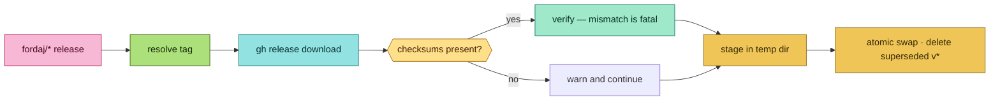

# The versioner bundle (`tools/versioner/`)

[Versioner](https://github.com/fordaj/Versioner) computes the version of this repository from its Git history, under the rules in `.versioner.json` (`defaultBranchVersion: 254`, `exemptBranches: { main: 0 }`, `tagPattern: v[0-9]*`). The release pipeline asks versioner for the next version, stamps it into every cross-compiled binary, tags the commit, and creates the GitHub release.

The pinned binary selection goes through the [env cascade](../../scripts/env.sh.md) (`VERSIONER_VERSION_DIR`/`VERSIONER_BIN`); `scripts/version.sh` prints what it computes, and `cmd/barnacle` resolves `--version` from the stamp it produces at build time.

## Bundled platforms

`v0.0.3.0.5/` — `macos-arm64`, `macos-x86_64`, `linux-arm64`, `linux-x86_64`, `windows-x86_64`. There is **no windows-arm64 bundle upstream** — the windows-arm64 platform file points `VERSIONER_BIN` at a `windows-x86_64` path that does not exist; set `VERSIONER_BIN` to a versioner on `PATH` if you need it there.

## `update.sh`

Refreshes from `fordaj/Versioner` releases: archives whose stems carry the `<os>-<arch>` suffix (any single separator, e.g. `Versioner_v0.0.3.0.5_darwin-arm64` → `macos-arm64`; `darwin-*`/`amd64`/`x64` are normalized onto the bundle layout). Verified against the release's `checksums.txt`/`SHA256SUMS.txt` when present (mismatch is fatal; missing checksums warn and install anyway). Only the binary is kept; the swap is staged atomically and superseded `v*/` directories are deleted afterwards. `--dry-run`, `--tag`, `--repo`; env `VERSIONER_REPO`, `VERSIONER_TAG`. Logging via `scripts/entry.sh`. See [../README.md](../README.md) for the shared bundle contract.

## Related pages

- [../README.md](../README.md) — the bundle index
- [../../scripts/version.sh.md](../../scripts/version.sh.md) — the wrapper that prints versioner's output
- [../../scripts/release.sh.md](../../scripts/release.sh.md) — the release pipeline built on it
- [../../scripts/env.sh.md](../../scripts/env.sh.md) — the cascade selecting `VERSIONER_BIN`
